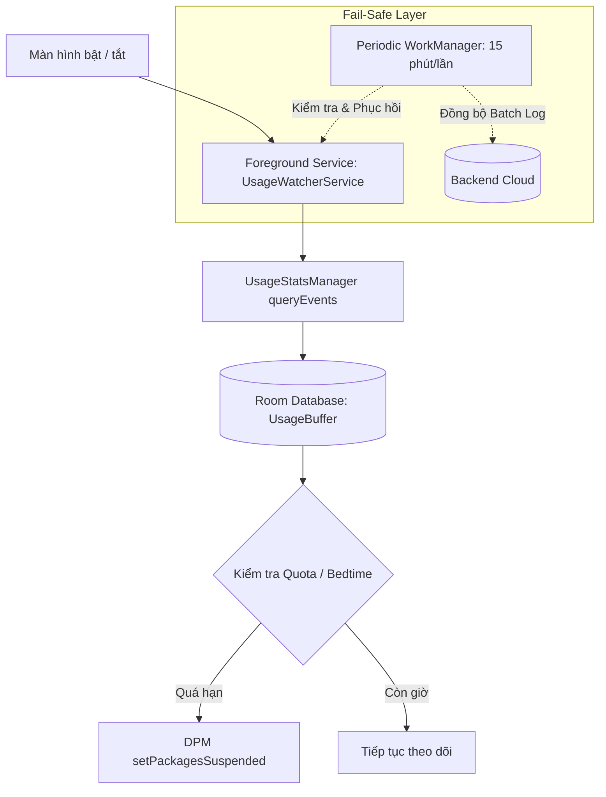

# 🔋 Quy Tắc Tối Ưu Năng Lượng & Dịch Vụ Chạy Ngầm (Battery & Background Engine Rules)

Tài liệu này là quy tắc kỹ thuật bắt buộc khi xây dựng công cụ theo dõi thời lượng sử dụng (`Usage Tracking Engine`) và các dịch vụ chạy ngầm trên **Target Agent (Child App)**.
Mục tiêu cốt lõi: **Thu thập dữ liệu chính xác đến mili-giây nhưng mức tiêu hao pin dưới 3-5%/ngày, không bị OS kill và không gây giật lag thiết bị**.

---

## ⚡ 1. Triết Lý Giám Sát Hiệu Năng Cao (High-Efficiency Tracking)

1. **Event-Driven Thay Vì Vòng Lặp Vô Tận (No Busy Waiting / Infinite Loops)**:
   - Tuyệt đối nghiêm cấm việc chạy `while(true)` hoặc `delay(100)` để liên tục kiểm tra app đang chạy. Việc này sẽ giữ CPU thức liên tục (CPU WakeLock) và làm cạn kiệt pin trong vòng vài giờ.
   - Sử dụng `UsageStatsManager.queryEvents()` với phạm vi truy vấn thu hẹp (`startTime` = mốc kiểm tra cuối, `endTime` = thời điểm hiện tại).
   - Lọc chính xác 2 sự kiện:
     - `UsageEvents.Event.ACTIVITY_RESUMED` (bắt đầu dùng ứng dụng).
     - `UsageEvents.Event.ACTIVITY_PAUSED` (dừng hoặc chuyển sang ứng dụng khác).

2. **Cơ Chế Polling Thích Ứng Theo Trạng Thái Màn Hình (Adaptive Screen-Aware Polling)**:
   - Đăng ký `BroadcastReceiver` lắng nghe `Intent.ACTION_SCREEN_ON` và `Intent.ACTION_SCREEN_OFF`.
   - **Khi màn hình BẬT (`SCREEN_ON`)**:
     - Chu kỳ kiểm tra usage: Mỗi **2 đến 3 giây** một lần để đảm bảo phát hiện ngay khi trẻ mở app bị cấm hoặc chạm mốc quota.
   - **Khi màn hình TẮT (`SCREEN_OFF`)**:
     - Lập tức ghi nhận sự kiện `ACTIVITY_PAUSED` cho app hiện tại.
     - Tạm dừng (Pause) polling ticker để đưa CPU vào trạng thái nghỉ sâu (Deep Sleep / Doze Mode).
     - Tuyệt đối không giữ WakeLock khi màn hình tắt.

---

## 🛠️ 2. Kiến Trúc Dịch Vụ Hai Lớp (Two-Tier Service Architecture)

1. **Lớp 1: Foreground Service Siêu Nhẹ (`UsageWatcherService`)**:
   - Khai báo Foreground Service Type phù hợp (Android 14+): `specialUse` hoặc `systemExempted` kết hợp quyền Device Owner.
   - Hiển thị thông báo Silent (độ ưu tiên thấp `IMPORTANCE_MIN`, không phát âm thanh rung, không gây phiền toái cho trẻ).
   - Tiến trình chỉ tiêu thụ < 20-30MB RAM.

2. **Lớp 2: Fail-Safe & Batch Ingestion với `WorkManager`**:
   - Khởi tạo `PeriodicWorkRequest` chạy định kỳ 15 phút một lần với ràng buộc mạng (`NetworkType.CONNECTED`).
   - Nhiệm vụ 1: Kiểm tra xem `UsageWatcherService` có đang hoạt động hay không; nếu bị kill bởi OS trong điều kiện cạn kiệt RAM, khởi động lại ngay.
   - Nhiệm vụ 2: Gom toàn bộ các bản ghi session trong Room DB và thực hiện upload batch lên Backend Server, giải phóng bộ đệm cục bộ.

---

## 🗄️ 3. Quản Lý Dữ Liệu Cục Bộ (Room Database & Offline Resilience)

1. **Bộ Đệm Cục Bộ (Local Buffer)**:
   - Mọi mốc thời gian sử dụng được cộng dồn theo từng ngày (tính theo múi giờ địa phương của thiết bị).
   - Bảng `daily_app_usage`:
     - `date`: YYYY-MM-DD
     - `package_name`: Tên gói ứng dụng
     - `foreground_duration_ms`: Tổng mili-giây đã sử dụng trong ngày
     - `last_sync_timestamp`: Mốc thời gian đã đồng bộ lên backend
   - Bảng `active_policies`:
     - `package_name`
     - `daily_limit_minutes`
     - `bedtime_start` / `bedtime_end`
     - `is_blocked`

2. **Quy Tắc Độc Lập Ngoại Tuyến (Offline First Rule Enforcement)**:
   - Local Rule Engine tự động so sánh `foreground_duration_ms` với `daily_limit_minutes`.
   - Khi vượt ngưỡng: Lập tức gọi `DevicePolicyManager.setPackagesSuspended(...)` ngay trên máy con mà **không cần chờ kết nối Internet hay phản hồi từ Backend**.
   - Khi sang ngày mới (00:00:00): Tự động reset bộ đếm ngày và gỡ bỏ suspend cho các ứng dụng có quota mới.

---

## 📉 4. Tiêu Chuẩn Nghiệm Thu Hiệu Năng & Pin (Battery Benchmark Criteria)

- [ ] **Mức tiêu thụ pin**: < 3-5% tổng thời lượng pin mỗi 24 giờ sử dụng thực tế.
- [ ] **CPU Usage**: Dưới 1% trung bình; không xuất hiện hiện tượng throttling hoặc làm nóng máy.
- [ ] **RAM Usage**: Bộ nhớ thường trực của Agent < 35MB; không có hiện tượng rò rỉ bộ nhớ (leak) khi chạy liên tục 48 giờ.
- [ ] **Độ lệch đo lường**: Thời gian sử dụng đo được lệch không quá 2 giây so với Digital Wellbeing của Google.
