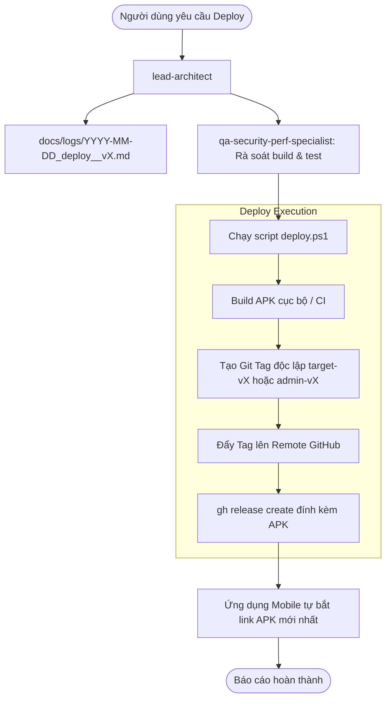

# 🚀 Kỹ Năng: Deploy & Cập Nhật Phiên Bản Từng Ứng Dụng (Deploy-App Skill)

Kỹ năng này hướng dẫn và cung cấp công cụ tự động để **Swarm Agent** và lập trình viên phát hành phiên bản mới độc lập cho:
1. `target-node`: Ứng dụng con nắm quyền **Android Device Owner (DO)**. Tải về và tự động cài đặt ngầm (Silent Install) qua GitHub Release.
2. `admin-node`: Ứng dụng di động **Parent Admin (Flutter)**. Thông báo cho phụ huynh khi có phiên bản mới trên GitHub Release.

---

## 🛠️ 1. Cấu Trúc Lệnh Triển Khai (`deploy.ps1`)

Kịch bản được cung cấp sẵn tại `.agents/skills/deploy-app/scripts/deploy.ps1`:

```powershell
powershell -ExecutionPolicy Bypass -File .agents/skills/deploy-app/scripts/deploy.ps1 `
  -Target <target|admin|all> `
  -Version <X.Y.Z> `
  -Notes "<Nội dung mô tả bản cập nhật>"
```

### Các Tham Số (Parameters):
- `-Target`:
  - `target`: Chỉ build và phát hành `target-node` (Child DO Agent) với tag `target-vX.Y.Z`.
  - `admin`: Chỉ build và phát hành `admin-node` (Parent App) với tag `admin-vX.Y.Z`.
  - `all`: Build và phát hành cả 2 ứng dụng với tag chung `vX.Y.Z`.
- `-Version`: Định dạng Semantic Versioning, ví dụ: `1.0.1`, `1.1.0`.
- `-Notes`: Ghi chú phát hành hiển thị trên GitHub Release (Release Notes).

---

## 🔄 2. Quy Trình Vận Hành Của Swarm Agent Khi Nhận Yêu Cầu Deploy

Khi người dùng yêu cầu: *"Deploy phiên bản mới cho target-node v1.0.2"* hoặc *"Phát hành app phụ huynh v1.0.1"*:



---

## 📦 3. Các Ví Dụ Thao Tác Điển Hình

### Ví dụ 1: Phát hành bản cập nhật cho máy con (`target-node`)
```powershell
powershell -ExecutionPolicy Bypass -File .agents/skills/deploy-app/scripts/deploy.ps1 `
  -Target target `
  -Version "1.0.1" `
  -Notes "Nâng cấp bảo mật Anti-Tampering, bổ sung tự động cấp quyền ngầm và sửa lỗi Room DB."
```
> **Cơ chế tại máy con**: Service `GitHubReleaseUpdater.kt` định kỳ gọi GitHub API, nhận thấy tag `target-v1.0.1` mới hơn phiên bản hiện tại, tự động tải APK `mdm-child-agent-1.0.1.apk` và thực thi **Silent Install** ngầm mà không làm phiền trẻ.

### Ví dụ 2: Phát hành bản cập nhật cho ứng dụng phụ huynh (`admin-node`)
```powershell
powershell -ExecutionPolicy Bypass -File .agents/skills/deploy-app/scripts/deploy.ps1 `
  -Target admin `
  -Version "1.0.1" `
  -Notes "Bổ sung biểu đồ PieChart phân loại ứng dụng, hỗ trợ SignalR WebSocket thời gian thực."
```
> **Cơ chế tại máy phụ huynh**: `github_release_updater.dart` phát hiện tag `admin-v1.0.1`, hiển thị banner cập nhật và liên kết tải bản cài đặt mới.

---

## 🔒 4. Nguyên Tắc An Toàn (Safety & Signing Rules)

1. **Khóa chữ ký (App Signing Key)**:
   - Các bản release của `target-node` bắt buộc phải được ký bằng cùng một Keystore (`release.keystore` hoặc `debug.keystore` trong giai đoạn dev). Nếu sai chữ ký, Android OS sẽ từ chối silent update của PackageInstaller để bảo vệ thiết bị.
2. **Kiểm tra trước khi Release**:
   - `qa-security-perf-specialist` phải đảm bảo APK build sạch, không dính lỗi lint hoặc compiler warning nghiêm trọng trước khi kích hoạt `deploy.ps1`.
