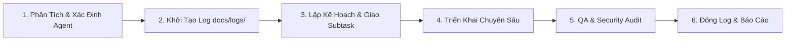

# 🐝 Swarm Dispatch Skill - Quy Trình Giao Việc & Điều Phối Swarm

Skill này hướng dẫn quy trình tiêu chuẩn để tiếp nhận yêu cầu từ người dùng, phân tách nhiệm vụ theo các Epic, giao việc cho các Swarm Subagents chuyên trách, giám sát chất lượng và tự động duy trì nhật ký truy vết (`docs/logs/*.md`).

---

## ⚡ Quy Trình 6 Bước Giao Việc & Thực Thi



---

### Bước 1: Tiếp Nhận & Phân Luồng Yêu Cầu Theo Epic
1. Đọc kỹ yêu cầu từ người dùng (`USER_REQUEST`) và đối chiếu với các tài liệu Epic trong `docs/epics/`:
   - `00_Tong_Quan_Kien_Truc_He_Thong.md`
   - `EPIC_01_Device_Owner_Core_Agent.md`
   - `EPIC_02_Usage_Tracking_Engine.md`
   - `EPIC_03_Policy_Enforcement_Blocking.md`
   - `EPIC_04_Backend_Orchestrator_Sync.md`
   - `EPIC_05_Parent_App_Management_UI.md`
2. Tra cứu [Ma Trận Điều Phối (Dispatch Matrix)](./references/dispatch_matrix.md) để xác định Agent chủ trì và các Agent phối hợp:
   - **`device-owner-specialist`**: Cấu hình Device Owner, `DeviceAdminReceiver`, ADB/QR Provisioning, chống gỡ app, `setPackagesSuspended`, `setApplicationHidden`, khóa ngày giờ/safe mode/guest user (EPIC 01 & 03).
   - **`usage-tracking-specialist`**: Đo thời gian dùng app qua `UsageStatsManager.queryEvents()`, Service chạy ngầm pin thấp, Room Database bộ đệm cục bộ, WorkManager, Local Rule Engine (EPIC 02).
   - **`backend-sync-specialist`**: API máy chủ, pairing QR/OTP, WebSocket/MQTT real-time command, FCM High-Priority Push, batch ingestion (EPIC 04).
   - **`parent-ui-specialist`**: Jetpack Compose Parent App, màn hình thống kê, quét QR pairing, thanh chỉnh quota, nút khóa khẩn cấp (EPIC 05).
   - **`qa-security-perf-specialist`**: Kiểm thử bảo mật chống bypass, kiểm tra Safe Mode, test rò rỉ RAM và tiêu hao pin (< 3-5%/ngày).
   - **`lead-architect`**: Điều phối liên module, thiết kế Clean Architecture, duyệt hợp đồng giao tiếp giữa các tầng.

---

### Bước 2: BẮT BUỘC - Khởi Tạo Nhật Ký Truy Vết (`docs/logs/`)
> [!IMPORTANT]
> Tuyệt đối không bắt tay vào sửa code khi chưa khởi tạo file log truy vết.

Chạy lệnh PowerShell sau để tự động tạo tệp log và đưa vào chỉ mục [`docs/logs/README.md`](../../docs/logs/README.md):
```powershell
powershell -ExecutionPolicy Bypass -File .agents/skills/swarm-dispatch/scripts/init_log.ps1 -TaskSlug "<slug_ngan_gon>" -TaskTitle "<Tên_nhiệm_vụ>" -AgentName "<ten_agent>"
```
*Ví dụ*:
```powershell
powershell -ExecutionPolicy Bypass -File .agents/skills/swarm-dispatch/scripts/init_log.ps1 -TaskSlug "setup_device_admin_receiver" -TaskTitle "Cấu hình DeviceAdminReceiver và chính sách Anti-Tampering ban đầu" -AgentName "device-owner-specialist"
```
*(Nếu môi trường không chạy được script, tạo thủ công tệp `docs/logs/YYYY-MM-DD_<slug>.md` dựa theo [Log Template](./resources/log_template.md) và thêm dòng tương ứng vào `docs/logs/README.md`).*

---

### Bước 3: Phân Bổ Nhiệm Vụ (Subtask Allocation)
- Nếu là tác vụ đơn module: Agent chủ trì thực hiện trực tiếp.
- Nếu là tác vụ phức tạp liên tầng (VD: Lệnh Khóa Khẩn Cấp từ Parent App xuống Target Agent qua WebSocket):
  - Dùng công cụ `invoke_subagent` để triệu hồi các subagent chuyên môn:
    - Triệu hồi `parent-ui-specialist` dựng giao diện nút Panic Lock và emit socket event.
    - Triệu hồi `backend-sync-specialist` dựng socket broker định tuyến event đến thiết bị con.
    - Triệu hồi `device-owner-specialist` xử lý nhận event và gọi `setPackagesSuspended`.
  - Quy định rõ ràng: Input/Output payload, hợp đồng dữ liệu, thời gian phản hồi mục tiêu (< 3s).

---

### Bước 4: Triển Khai Chuyên Sâu & Giữ Vững Kiến Trúc
Mỗi agent khi thực hiện phải tuân thủ nghiêm ngặt:
1. **Zero-Bypass Policy**: Tuyệt đối không dùng Overlay Window; bắt buộc dùng `setPackagesSuspended` và các hạn chế `UserManager`.
2. **Offline-First Resilience**: Máy con phải tự quản lý quota cục bộ bằng Room DB và tự suspend khi hết giờ ngay cả khi mất mạng.
3. **Tiết Kiệm Pin**: Polling thích ứng theo trạng thái màn hình (`SCREEN_ON` vs `SCREEN_OFF`), giải phóng WakeLock ngay khi tắt màn hình.
4. **Clean Code & Coroutines**: Toàn bộ thao tác I/O/DB trên `Dispatchers.IO`, UI trên `Dispatchers.Main.immediate`.

---

### Bước 5: Kiểm Thử & Đánh Giá Bảo Mật (QA & Security Audit)
Trước khi kết thúc, `qa-security-perf-specialist` (hoặc agent chủ trì) tiến hành:
- Rà soát bề mặt tấn công: Safe Mode, Force Stop, lùi giờ hệ thống, tạo tài khoản Guest.
- Đo đạc thời lượng pin và kiểm tra rò rỉ bộ nhớ (leak-free).
- Chạy kiểm tra biên dịch, unit test và integration test.

---

### Bước 6: Hoàn Thiện Log & Báo Cáo Kết Quả
1. Cập nhật nội dung chi tiết vào file log `docs/logs/YYYY-MM-DD_<slug>.md`:
   - Điền đầy đủ mục **2. Chi Tiết Các Bước Thực Hiện**.
   - Điền danh sách tệp thay đổi tại mục **3. Danh Sách Tệp Thay Đổi**.
   - Điền kết quả kiểm thử tại mục **4. Kiểm Thử & Đánh Giá Bảo Mật**.
   - Chuyển `Trạng thái: 🔄 Đang tiến hành` thành `Trạng thái: ✅ Hoàn thành`.
2. Cập nhật trạng thái thành `✅ Hoàn thành` trong [`docs/logs/README.md`](../../docs/logs/README.md).
3. Báo cáo tổng kết cho người dùng kèm các đường dẫn liên kết đến tệp mã nguồn và tệp log.
