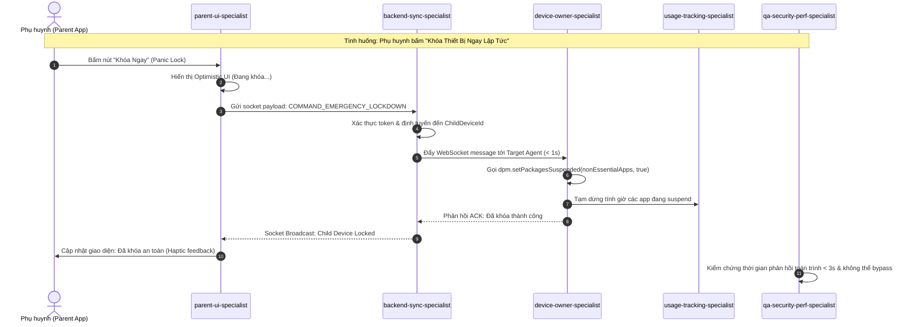

# 🧭 Ma Trận Điều Phối Nhiệm Vụ (Swarm Dispatch Matrix)

Ma trận này dùng để xác định chính xác Agent chịu trách nhiệm chính và các Agent hỗ trợ dựa trên loại tác vụ và gói mã nguồn bị ảnh hưởng trong dự án **MDM Parental Control**.

---

## 1. Phân Luồng Theo Lĩnh Vực Chuyên Môn & Epics

| Lĩnh vực / Hạng mục | Epic liên quan | Agent Phụ Trách Chính | Agent Phối Hợp | Thư Mục / Tệp Trọng Tâm |
| :--- | :--- | :--- | :--- | :--- |
| **Kiến Trúc Hệ Thống & Hợp Đồng Giao Tiếp** | Toàn bộ Epics | `lead-architect` | Toàn bộ Swarm | `shared/contracts/`, Root gradle, DI setup |
| **Device Owner Setup & Anti-Tampering** | **EPIC 01** | `device-owner-specialist` | `qa-security-perf` (Bypass test) | `child-agent/.../receiver/`, `AntiTamperManager.kt` |
| **Kích Hoạt DO (ADB / QR Provisioning)** | **EPIC 01** | `device-owner-specialist` | `lead-architect` | `provisioning/`, `device_admin_receiver.xml` |
| **Tự Động Cấp Quyền Hệ Thống (Silent Grant)** | **EPIC 01** | `device-owner-specialist` | `usage-tracking` | `SilentPermissionManager.kt` |
| **UsageStats Engine & Foreground Service** | **EPIC 02** | `usage-tracking-specialist` | `qa-security-perf` (Battery) | `child-agent/.../service/`, `UsageStatsWatcher.kt` |
| **Room Local Buffer & Quota Calculation** | **EPIC 02** | `usage-tracking-specialist` | `device-owner` (Trigger suspend) | `child-agent/.../data/local/`, `UsageDatabase.kt` |
| **Phân Loại Ứng Dụng (App Categorization)** | **EPIC 02** | `usage-tracking-specialist` | `backend-sync` (Catalog) | `child-agent/.../classifier/` |
| **Khóa Ứng Dụng HĐH (`setPackagesSuspended`)** | **EPIC 03** | `device-owner-specialist` | `usage-tracking` (Quota events) | `child-agent/.../enforcement/AppSuspensionManager.kt` |
| **Ẩn Ứng Dụng Vĩnh Viễn (`setApplicationHidden`)** | **EPIC 03** | `device-owner-specialist` | `backend-sync` (Blacklist) | `child-agent/.../enforcement/` |
| **Bedtime Mode & Local Rule Engine** | **EPIC 03** | `device-owner-specialist` | `usage-tracking-specialist` | `child-agent/.../enforcement/BedtimeManager.kt` |
| **Backend REST API & Identity Service** | **EPIC 04** | `backend-sync-specialist` | `lead-architect` | `backend/src/modules/auth/`, `pairing/` |
| **Kênh WebSocket / MQTT & FCM High-Priority** | **EPIC 04** | `backend-sync-specialist` | `device-owner`, `parent-ui` | `backend/src/realtime/`, `fcm/` |
| **Ingestion Pipeline & Time-Series Aggregation** | **EPIC 04** | `backend-sync-specialist` | `usage-tracking` (Batch log) | `backend/src/ingestion/`, `analytics/` |
| **Màn Hình Compose Parent App & Thống Kê** | **EPIC 05** | `parent-ui-specialist` | `backend-sync` (Data API) | `parent-app/.../ui/screens/dashboard/` |
| **Bộ Điều Khiển Giới Hạn & Lịch Biểu UI** | **EPIC 05** | `parent-ui-specialist` | `backend-sync` (Policy API) | `parent-app/.../ui/screens/rules/` |
| **Nút Khóa Khẩn Cấp (Lockdown) & Cấp Thêm Giờ** | **EPIC 05** | `parent-ui-specialist` | `backend-sync` (Socket command) | `parent-app/.../ui/components/QuickActions.kt` |
| **Quét Mã Ghép Nối 1 Bước (QR Pairing)** | **EPIC 05** | `parent-ui-specialist` | `backend-sync` (Handshake) | `parent-app/.../ui/screens/pairing/` |
| **Kiểm Thử Bảo Mật, Anti-Bypass & Safe Mode** | Toàn bộ Epics | `qa-security-perf-specialist` | `device-owner-specialist` | `tests/security/`, `tests/bypass/` |
| **Kiểm Thử Năng Lượng & Rò Rỉ Bộ Nhớ (Battery)** | Toàn bộ Epics | `qa-security-perf-specialist` | `usage-tracking-specialist` | Profiling scripts, Battery Historian |

---

## 2. Sơ Đồ Phối Hợp Đa Agent (Multi-Agent Interaction Sequence)

