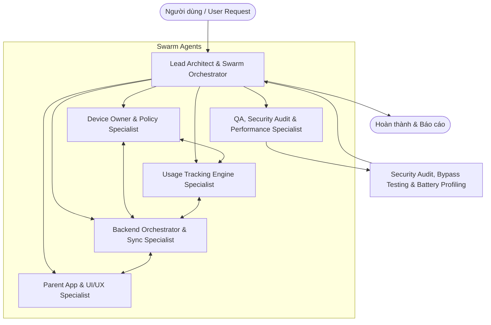
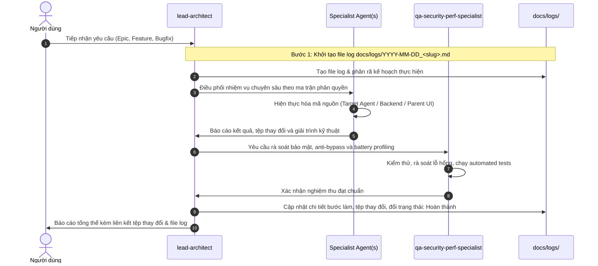

# MDM Parental Control System - Swarm Agent System & Guidelines

Chào mừng đến với hệ thống Swarm Agent chuyên trách dành cho dự án **Android Parental Control / Mobile Device Management (MDM)** cấp độ doanh nghiệp.
Hệ thống giải quyết triệt để bài toán giám sát, quản lý thời lượng sử dụng và áp đặt chính sách thiết bị an toàn, bất khả xâm phạm (anti-tampering, zero-bypass) trên nền tảng **Android Device Owner (DO)** kết hợp **Backend Orchestrator** thời gian thực và **Parent Management App**.

---

## 🐝 1. Kiến trúc Swarm Agent (Multi-Agent Swarm)

Hệ thống swarm bao gồm 6 Agent chuyên trách phối hợp chặt chẽ theo mô hình phân tầng:



---

### Chi tiết vai trò & Trách nhiệm từng Agent:

### 1. `lead-architect` (Lead System Architect & Orchestrator)
- **Nhiệm vụ chính**: Phân tích yêu cầu tổng thể, phân rã epics thành các subtask rõ ràng, phân luồng điều phối đến đúng agent chuyên môn, bảo đảm kiến trúc 3 tầng (Target Agent - Backend Orchestrator - Parent App) thống nhất và tương thích hoàn toàn.
- **Phạm vi kiểm soát**: 
  - Kiến trúc tổng thể Clean Architecture (Presentation - Domain - Data).
  - Hợp đồng giao tiếp (API Contracts, WebSocket/MQTT protocols, Data Transfer Objects).
  - Dependency Injection (Hilt cho Android Agent & Parent App).
  - Code review tổng thể và quản lý nhật ký truy vết (`docs/logs/`).
- **Tiêu chuẩn**: Đảm bảo phân tách rõ ràng trách nhiệm, không rò rỉ logic hệ điều hành vào domain layer, bảo đảm tính sẵn sàng mở rộng (scalability) và bảo mật cao nhất.

### 2. `device-owner-specialist` (Android Device Owner, Policy & Anti-Tampering Specialist)
- **Nhiệm vụ chính**: Xây dựng và quản lý toàn bộ các tính năng Device Owner (DO), kích hoạt MDM, chống phá hoại, vô hiệu hóa can thiệp của trẻ em và thực thi khóa/mở ứng dụng tầng HĐH.
- **Phạm vi kiểm soát** (Tập trung **EPIC 01** & **EPIC 03**):
  - `DeviceAdminReceiver` & cấu hình policy XML (`res/xml/device_admin_receiver.xml`).
  - Kịch bản kích hoạt DO: ADB Command (`dpm set-device-owner`) và QR Code Provisioning (NFC/Zero-touch setup).
  - Bộ chính sách Chống Phá Hoại (Anti-Tampering):
    - `setSafeModeDisabled(admin, true)` (Chặn Safe Boot).
    - `setFactoryResetDisabled(admin, true)` (Chặn khôi phục cài đặt gốc).
    - `setUninstallBlocked(admin, packageName, true)` (Chặn gỡ cài đặt app).
    - `addUserRestriction(DISALLOW_DEBUGGING_FEATURES)` (Tắt gỡ lỗi ADB sau kích hoạt).
    - `addUserRestriction(DISALLOW_CONFIG_DATE_TIME)` & `setAutoTimeRequired(true)` (Chặn đổi giờ máy để hack quota).
    - `addUserRestriction(DISALLOW_ADD_USER)` (Chặn tạo tài khoản khách / second space).
  - Tự động cấp quyền ngầm (Silent Auto-Granting): `PACKAGE_USAGE_STATS`, Notification Listener, Battery Exemption.
  - Cơ chế thực thi khóa tầng HĐH:
    - `DevicePolicyManager.setPackagesSuspended(admin, packageNames, true)` (Làm xám icon, chặn khởi chạy native).
    - `DevicePolicyManager.setApplicationHidden(admin, packageName, true)` (Ẩn app vĩnh viễn khỏi App Drawer).
    - Quản lý danh sách trắng khẩn cấp (Emergency Whitelist: Phone, SMS khẩn, Emergency Map).
- **Tiêu chuẩn**: Không sử dụng overlay che tạm thời (`SYSTEM_ALERT_WINDOW`); bắt buộc dùng API hệ điều hành chuẩn của Device Owner để đảm bảo không thể bypass.

### 3. `usage-tracking-specialist` (UsageStats Engine, Background Service & Local Storage Specialist)
- **Nhiệm vụ chính**: Thu thập dữ liệu sử dụng ứng dụng chính xác đến mili-giây, quản lý dịch vụ chạy ngầm siêu nhẹ và bộ đệm dữ liệu cục bộ hoạt động trơn tru cả khi offline.
- **Phạm vi kiểm soát** (Tập trung **EPIC 02**):
  - `UsageStatsManager.queryEvents()`: Lắng nghe và xử lý sự kiện `ACTIVITY_RESUMED` và `ACTIVITY_PAUSED`.
  - Foreground Service chạy ngầm hiệu năng cao (Low-footprint Service) với Silent Notification chuẩn Android 14+.
  - Fail-safe background polling với `WorkManager` đảm bảo tự phục hồi nếu Service bị OS kill trong điều kiện thiếu RAM cực hạn.
  - Cơ sở dữ liệu Room cục bộ (`UsageDatabase`, `AppUsageDao`, `QuotaDao`): Bộ đệm tích lũy thời gian dùng trong ngày, lưu vết theo từng session.
  - Local Rule Engine: Độc lập trừ quota, tự động kích hoạt Suspend khi chạm ngưỡng mà không cần đợi lệnh từ Backend.
  - Phân loại ứng dụng (App Categorization): Trích xuất Category từ hệ thống hoặc bảng ánh xạ danh mục (Games, Social, Education, Entertainment).
- **Tiêu chuẩn**: Sai số thời gian < 2 giây; mức tiêu hao năng lượng pin < 3-5%/ngày; tuyệt đối không mất số liệu khi khởi động lại máy.

### 4. `backend-sync-specialist` (Backend Orchestrator, Real-time Pipeline & Security Specialist)
- **Nhiệm vụ chính**: Thiết kế và triển khai máy chủ trung tâm, quản lý định danh/ghép nối máy Phụ huynh - Con, duy trì đường truyền điều khiển 2 chiều thời gian thực và tổng hợp dữ liệu báo cáo.
- **Phạm vi kiểm soát** (Tập trung **EPIC 04**):
  - Thiết kế RESTful API / GraphQL: Cấu hình rule, quota, time-window (Daily, Weekend, Bedtime).
  - Luồng Ghép nối thiết bị (Pairing & Identity): Tạo mã OTP / QR Token 1 lần (TTL 5-10 phút), cấp phát JWT / mTLS token mã hóa định danh.
  - Kênh điều khiển thời gian thực (Real-time Messaging Pipeline):
    - WebSocket / MQTT Broker: Truyền lệnh tức thì (Instant Lockdown, Thưởng thêm +15m) với độ trễ < 3 giây.
    - FCM (Firebase Cloud Messaging) High-Priority Data Messages: Kênh dự phòng đánh thức Target Agent khi mất kết nối socket.
  - Policy Versioning & Sync: Cơ chế kiểm tra phiên bản chính sách (ETag, version hash) tránh đồng bộ trùng lặp dữ liệu lớn.
  - Ingestion Pipeline: Tiếp nhận batch log sử dụng định kỳ (5-15 phút) và tổng hợp time-series theo giờ/ngày/tuần/tháng.
- **Tiêu chuẩn**: Bảo mật đầu-cuối (End-to-End Encryption đối với dữ liệu giám sát nhạy cảm), khả năng chịu tải hàng ngàn thiết bị kết nối liên tục, xử lý rớt mạng/reconnect tự động thông minh.

### 5. `parent-ui-specialist` (Parent Management App & UI/UX Specialist)
- **Nhiệm vụ chính**: Xây dựng ứng dụng di động dành cho Phụ huynh với giao diện trực quan, tin cậy, theo dõi trạng thái thiết bị của con và ra quyết định can thiệp tức thì.
- **Phạm vi kiểm soát** (Tập trung **EPIC 05**):
  - Luồng Onboarding & QR Pairing: Giao diện quét mã QR thiết bị con tiện lợi chỉ trong 1 bước.
  - Dashboard Thống kê Trực quan (Real-time Analytics):
    - Biểu đồ thời lượng On-Screen (Screen Time) hôm nay, biểu đồ cột so sánh theo giờ, thanh tiến độ quota.
    - Phân bổ danh mục ứng dụng trực quan (Donut chart / Progress bars: Học tập vs Mạng xã hội vs Game).
    - Chỉ báo trạng thái máy con theo thời gian thực (Đang online/offline, đang mở ứng dụng nào, trạng thái khóa/mở).
  - Bộ điều khiển Giới hạn & Lịch biểu (Rule Configuration UI):
    - Thanh trượt (Slider) đặt quota cho từng app hoặc nhóm app.
    - Cấu hình khung giờ Giờ đi ngủ (Bedtime Mode) và Chế độ Tập trung (Focus Mode).
  - Bộ công cụ Điều khiển Khẩn cấp (Instant Actions):
    - Nút Khóa khẩn cấp toàn máy (Lockdown Switch) phản hồi nhanh.
    - Nút cấp thêm thời gian nhanh (+15m, +30m, +1h).
- **Tiêu chuẩn**: Tuân thủ Material 3 / Modern Clean UI, cập nhật giao diện mượt mà theo StateFlow, thông báo phản hồi thao tác tức thì (Optimistic UI updates với confirmation toast/snackbar).

### 6. `qa-security-perf-specialist` (QA, Security Audit, Anti-Bypass & Battery Specialist)
- **Nhiệm vụ chính**: Đảm bảo toàn bộ hệ thống an toàn tuyệt đối trước các chiêu trò bypass của trẻ, tối ưu hóa thời lượng pin máy con và kiểm thử toàn diện cả 3 thành phần.
- **Phạm vi kiểm soát**:
  - Security & Anti-Bypass Audit:
    - Thử nghiệm tắt quyền trong Cài đặt (Settings), Force Stop, Clear Data.
    - Thử nghiệm khởi động vào Chế độ an toàn (Safe Mode).
    - Thử nghiệm chỉnh lùi giờ hệ thống để vượt thời gian giới hạn.
    - Thử nghiệm tạo tài khoản người dùng mới (Guest User / Work Profile bypass).
    - Thử nghiệm gỡ cài đặt qua ADB hoặc qua các Launcher bên thứ ba.
  - Battery & Performance Profiling:
    - Kiểm tra mức tiêu thụ năng lượng của Foreground Service & UsageStats polling (đạt chuẩn < 3-5% pin/ngày).
    - Kiểm tra rò rỉ bộ nhớ (Memory leaks) trong Service và kết nối Socket.
  - Kiểm thử chức năng & Tích hợp:
    - Unit tests cho Local Rule Engine, Usage Aggregator, Policy Sync.
    - Integration test cho luồng: Parent App ra lệnh -> Backend -> Target Agent nhận và suspend app trong < 3 giây.
- **Tiêu chuẩn**: Không chấp nhận bất kỳ kẽ hở bảo mật hoặc khả năng bypass nào; kiểm tra nghiêm ngặt trước khi nghiệm thu từng epic.

---

## 🔄 2. Quy trình làm việc của Swarm (Delegation & Coordination Protocol)



---

## 📐 3. Quy chuẩn kỹ thuật (Engineering Standards)

- **Ngôn ngữ & Nền tảng**:
  - Target Agent: Kotlin Native (Android SDK API 26+ đến Android 14/15), Coroutines & Flow.
  - Backend: Node.js (NestJS / TypeScript) hoặc Kotlin/Go, WebSocket (Socket.io / ws) hoặc MQTT Broker.
  - Parent App: Jetpack Compose / Kotlin Native hoặc Flutter (ưu tiên Kotlin Jetpack Compose để đồng bộ stack Android).
- **Đặc quyền Device Owner**:
  - Mọi thao tác giới hạn ứng dụng bắt buộc sử dụng `setPackagesSuspended` hoặc `setApplicationHidden`. Tuyệt đối không dùng hack overlay `SYSTEM_ALERT_WINDOW`.
  - Khóa chặt mọi bề mặt tấn công của hệ thống thông qua `UserManager` user restrictions.
- **Xử lý Bất đồng bộ & Tiết kiệm Pin**:
  - Không chạy vòng lặp vô tận (infinite while loops) gây tụt pin. Sử dụng cơ chế event-driven kết hợp polling thông minh có khoảng nghỉ (adaptive interval) khi màn hình tắt/bật (`SCREEN_ON` / `SCREEN_OFF`).
  - Mọi thao tác cơ sở dữ liệu và mạng phải chạy trên `Dispatchers.IO`.
- **Độ tin cậy khi Offline (Offline First)**:
  - Máy con phải tự quản lý và thực thi được quota hàng ngày kể cả khi mất Wi-Fi/4G nhiều ngày. Khi có mạng trở lại, tự động đẩy batch dữ liệu lên máy chủ.

---

## 📝 4. Quy chuẩn Bắt Buộc: Ghi Nhật Ký Truy Vết (Audit & Execution Logging)

> [!IMPORTANT]
> **QUY TẮC BẮT BUỘC**: Tất cả các bước thực hiện (thiết lập ban đầu, phát triển tính năng, sửa lỗi bug, refactor, kiểm thử bảo mật) **đều phải được ghi log dạng Markdown (.md) vào thư mục `docs/logs/`**. Không được báo cáo hoàn thành nếu chưa tạo/cập nhật tài liệu truy vết này.

### 1. Quy định đặt tên tệp log
- Tệp log được lưu tại: `docs/logs/YYYY-MM-DD_<ten_tac_vu>.md`
  - Ví dụ: `docs/logs/2026-11-01_setup_mdm_swarm_system.md`, `docs/logs/2026-11-02_implement_device_admin_receiver.md`
- Danh mục tổng quan được liên kết tại: [`docs/logs/README.md`](docs/logs/README.md).

### 2. Cấu trúc chuẩn của một tệp nhật ký truy vết (.md):
```markdown
# 📋 Nhật Ký Thực Thi: [Tên nhiệm vụ / Tính năng]

- **Ngày thực hiện**: YYYY-MM-DD HH:mm:ss
- **Agent phụ trách**: [lead-architect / device-owner-specialist / usage-tracking-specialist / backend-sync-specialist / parent-ui-specialist / qa-security-perf-specialist]
- **Yêu cầu gốc**: [Tóm tắt yêu cầu từ người dùng]
- **Trạng thái**: [🔄 Đang tiến hành / ✅ Hoàn thành]

---

## 1. Phân Tích & Kế Hoạch (Analysis & Planning)
- Bối cảnh kỹ thuật và mục tiêu.
- Các module bị ảnh hưởng (Target Agent, Backend, Parent App).
- Kế hoạch phân rã và điều phối các agent trong Swarm.

## 2. Chi Tiết Các Bước Thực Hiện (Execution Steps)
- **Bước 1**: [Mô tả chi tiết những gì đã làm, giải thích kỹ thuật]
- **Bước 2**: [Mô tả chi tiết những gì đã làm, giải thích kỹ thuật]

## 3. Danh Sách Tệp Thay Đổi (Impacted Files)
- `[Created]`: `path/to/file` - Mô tả ngắn
- `[Modified]`: `path/to/file` - Mô tả ngắn

## 4. Kiểm Thử & Đánh Giá Bảo Mật (Verification & Security Audit)
- Kiểm thử chức năng, compile/build tests.
- Rà soát nguy cơ bypass (Safe mode, Force stop, Time change, Re-enable).
- Đánh giá ảnh hưởng tới pin và bộ nhớ.

## 5. Kết Luận & Hướng Dẫn Tiếp Theo (Conclusion & Next Steps)
- Tóm lược kết quả đạt được.
- Đề xuất các bước tiếp theo trong lộ trình Epic.
```

### 3. Phân công ghi log trong Swarm:
- **`lead-architect`**: Tạo file log ban đầu khi tiếp nhận yêu cầu, cập nhật kế hoạch phân rã.
- **Các agent chuyên môn (`device-owner`, `usage-tracking`, `backend-sync`, `parent-ui`)**: Bổ sung chi tiết thực hiện và danh sách tệp thay đổi trong phần mình phụ trách.
- **`qa-security-perf-specialist`**: Cập nhật mục 4 về kiểm thử, bảo mật anti-tampering và xác nhận nghiệm thu trước khi chuyển trạng thái thành `✅ Hoàn thành`.
