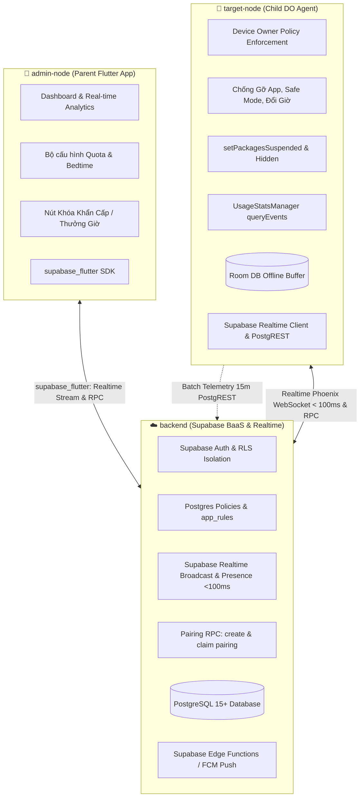

# 🛡️ MDM Parental Control System

[-brightgreen.svg)](https://developer.android.com)
[]()
[](https://supabase.com)
[-blue.svg)]()
[]()

> **Hệ thống giám sát, quản lý thời lượng sử dụng và áp đặt chính sách thiết bị Android (Parental Control / Mobile Device Management) cấp độ doanh nghiệp.**  
> Khắc phục triệt để các nhược điểm của các ứng dụng quản lý thông thường (dễ bị bypass, force stop, tắt Accessibility, đổi giờ máy hoặc khởi động vào Safe Mode) bằng cách áp dụng đặc quyền **Android Device Owner (DO)** kết hợp **Hạ tầng Supabase BaaS & Realtime** thời gian thực và **Parent Admin App**.

---

## 🏛️ Kiến Trúc Hệ Thống (3-Tier Architecture Với Supabase)

Dự án được phân chia thành 3 project con độc lập trong cùng một kho mã nguồn:



---

## ✨ Tính Năng Nổi Bật (Key Highlights)

- 🔒 **Chống Phá Hoại Bất Khả Xâm Phạm (Zero-Bypass Anti-Tampering)**:
  - Khóa Chế độ an toàn (`setSafeModeDisabled`): Ngăn khởi động vào Safe Mode.
  - Khóa khôi phục cài đặt gốc (`setFactoryResetDisabled`): Ngăn xóa trắng máy để thoát quản trị.
  - Chống gỡ cài đặt (`setUninstallBlocked`): Nút "Uninstall" và "Force Stop" bị vô hiệu hóa trong Settings.
  - Chống đổi ngày giờ hệ thống (`DISALLOW_CONFIG_DATE_TIME` & `setAutoTimeRequired`): Ngăn chỉnh lùi giờ để hack quota.
  - Chống tạo tài khoản khách (`DISALLOW_ADD_USER`): Ngăn tạo Guest User / Second Space để lách luật.
  - Tự cấp quyền ngầm (Silent Auto-Grant): Cấp `PACKAGE_USAGE_STATS` và bỏ qua tối ưu pin không cần hỏi người dùng.

- 🛑 **Khóa Ứng Dụng Chuẩn Hệ Điều Hành (Native OS Suspension)**:
  - Sử dụng API chuẩn `setPackagesSuspended`: Icon ứng dụng tự động xám màu trên mọi Launcher, chặn khởi chạy native từ tầng `ActivityTaskManager`. Tuyệt đối không dùng overlay window giả tạo (`SYSTEM_ALERT_WINDOW`).
  - Ẩn ứng dụng Blacklist vĩnh viễn bằng `setApplicationHidden`.
  - Danh sách trắng khẩn cấp (Emergency Whitelist): Luôn bảo vệ Gọi điện khẩn (112, 113, 114, 115), SMS khẩn và Bản đồ.

- ⚡ **Engine Giám Sát Siêu Nhẹ & Tối Ưu Năng Lượng**:
  - Đọc chính xác mili-giây qua `UsageStatsManager.queryEvents()` (`ACTIVITY_RESUMED`, `ACTIVITY_PAUSED`).
  - Adaptive Polling: Tự động ngắt hoàn toàn ticker và thả lỏng CPU khi màn hình tắt (`SCREEN_OFF`).
  - Tiêu thụ pin cực thấp: **< 3-5%/ngày**, bộ nhớ thường trực **< 30MB RAM**.

- 🌐 **Độc Lập Ngoại Tuyến (Offline-First)**:
  - Bộ đệm Room Database cục bộ: Tự tính toán trừ quota và tự suspend ứng dụng khi hết giờ ngay cả khi ngắt kết nối mạng nhiều ngày.
  - Tự động reset và mở khóa lúc 00:00:00 hàng ngày.

- ⏱️ **Kênh Điều Khiển Khẩn Cấp Thời Gian Thực (< 3 Giây)**:
  - Tích hợp **ASP.NET Core SignalR** kết hợp **Redis Backplane**: Lệnh Khóa khẩn cấp (Panic Lockdown) và Cấp thêm giờ (+15m, +30m) được truyền tới máy con tức thì.
  - Kênh dự phòng **FCM High-Priority Push** tự động đánh thức Agent khi socket bị gián đoạn.

- 📷 **Ghép Nối 1 Bước Bằng QR Code**:
  - Máy con sinh mã QR động kèm OTP 6 số (TTL 5 phút).
  - Phụ huynh quét bằng camera là hoàn tất ghép nối ngay lập tức.

---

## 📂 Cấu Trúc Thư Mục Dự Án

```
mdm-parental-control/
├── .agents/                      # Hệ thống Swarm Agent & Kỹ năng điều phối
│   ├── rules/                    # Quy tắc kỹ thuật bắt buộc
│   │   ├── device-owner-security-rules.md   # Quy tắc Device Owner & Anti-Tampering
│   │   ├── battery-background-rules.md      # Quy tắc pin & chạy ngầm siêu nhẹ
│   │   └── parent-app-ui-rules.md           # Quy tắc UI/UX Parent App
│   └── skills/                   # Kỹ năng Swarm
│       ├── mdm-swarm/            # Cẩm nang vận hành 5 Epics
│       └── swarm-dispatch/       # Quy trình giao việc & init_log.ps1
│
├── target-node/                  # [Child Agent] Ứng dụng Android Device Owner
│   └── README.md                 # Tài liệu chi tiết thành phần Target Node
│
├── backend/                      # [Central Server] ASP.NET Core 8 Web API & SignalR
│   └── README.md                 # Tài liệu chi tiết thành phần Backend
│
├── admin-node/                   # [Parent App] Ứng dụng Quản trị Phụ huynh
│   └── README.md                 # Tài liệu chi tiết thành phần Admin Node
│
├── docs/                         # Tài liệu hệ thống
│   ├── epics/                    # Đặc tả chi tiết các Epics
│   │   ├── 00_Tong_Quan_Kien_Truc_He_Thong.md
│   │   ├── target_node_epics.md  # 5 Epics chi tiết cho Target Node
│   │   ├── backend_epics.md      # 5 Epics chi tiết cho Backend
│   │   └── admin_node_epics.md   # 5 Epics chi tiết cho Admin Node
│   └── logs/                     # Nhật ký truy vết Swarm (Audit Logs)
│       ├── README.md             # Bảng chỉ mục lịch sử thực thi
│       └── *.md                  # Từng phiên thực thi chi tiết
│
├── AGENTS.md                     # Tài liệu điều phối tổng thể Swarm Agent
└── README.md                     # Tài liệu giới thiệu tổng quan dự án (tệp này)
```

---

## 🐝 Hệ Thống Swarm Agent Chuyên Trách

Dự án được xây dựng và bảo trì bởi hệ sinh thái **Multi-Agent Swarm** với 6 Agent phối hợp chặt chẽ:

1. **`lead-architect`**: Kiến trúc sư trưởng, quy hoạch Clean Architecture, hợp đồng giao tiếp giữa các tầng và quản lý nhật ký truy vết.
2. **`device-owner-specialist`**: Chuyên gia Android Device Owner, Anti-tampering, `setPackagesSuspended`, `setApplicationHidden` và phân quyền hệ điều hành.
3. **`usage-tracking-specialist`**: Chuyên gia UsageStats Engine, Room Database, Local Rule Engine và tối ưu hóa pin.
4. **`backend-sync-specialist`**: Chuyên gia ASP.NET Core Web API, SignalR Hubs, Ingestion Pipeline và Redis Pub/Sub.
5. **`parent-ui-specialist`**: Chuyên gia giao diện người dùng Parent App, biểu đồ thời gian thực và trải nghiệm phản hồi tức thì.
6. **`qa-security-perf-specialist`**: Chuyên gia kiểm thử bảo mật chống bypass, kiểm tra Safe Mode, test rò rỉ RAM và benchmark pin (< 3-5%/ngày).

> Chi tiết phân công và quy trình phối hợp xem tại [`AGENTS.md`](./AGENTS.md).

---

## 🛠️ Công Nghệ Chuẩn Hóa (Tech Stack)

| Thành Phần | Công Nghệ Chính | Thành Phần Chi Tiết & Thư Viện |
| :--- | :--- | :--- |
| **`target-node`** | **Kotlin Native Android** | Android SDK (Min 26, Target 34/35), Coroutines & Flow, AndroidX Room DB, WorkManager, Hilt DI, SignalR Java Client, Firebase Cloud Messaging. |
| **`backend`** | **ASP.NET Core (.NET 8 LTS)** | Kestrel Web API, SignalR Hubs, `System.Threading.Channels`, EF Core 8 (PostgreSQL), Dapper, Redis (`StackExchange.Redis`), Hangfire, `FirebaseAdmin` SDK. |
| **`admin-node`** | **Mobile App (Flutter / Compose)** | Real-time Charts (`fl_chart` / Canvas), Camera QR Scanner (`mobile_scanner` / CameraX), SignalR Client, Material 3 Design System. |

---

## 🚀 Hướng Dẫn Kích Hoạt Device Owner (Target Node)

### Cách 1: Kích hoạt qua ADB (Dành cho máy đang dùng không wipe data)
```bash
# 1. Tạm thời gỡ tài khoản Google trong Settings -> Accounts (nếu có)
# 2. Cài đặt APK Target Agent vào máy con:
adb install -r target-node/app/build/outputs/apk/debug/app-debug.apk

# 3. Kích hoạt quyền Device Owner tối cao:
adb shell dpm set-device-owner com.mdm.parentalcontrol.child/.receiver.MdmDeviceAdminReceiver

# 4. Xác nhận thành công: Hệ thống báo "Success: Device owner set to package..."
```

### Cách 2: Kích hoạt qua mã QR Provisioning (Dành cho máy mới hoặc sau Factory Reset)
- Tại màn hình "Chào mừng" (Welcome Setup Wizard) sau khi bật nguồn hoặc khôi phục cài đặt gốc, chạm nhanh **6 lần** vào bất kỳ vị trí trống nào trên màn hình để mở camera quét mã QR.
- Quét mã QR cấu hình chứa đường link tải APK và mã băm SHA-256 để máy tự động cấu hình Device Owner ngầm mà không cần cắm cáp.

---

## 📝 Quy Định Ghi Nhật Ký Truy Vết (Audit Logging)

Mọi thay đổi mã nguồn, tính năng mới, sửa lỗi bug hoặc bài test bảo mật đều phải tuân thủ quy chuẩn ghi nhật ký thực thi Markdown vào thư mục [`docs/logs/`](./docs/logs/):
```powershell
powershell -ExecutionPolicy Bypass -File .agents/skills/swarm-dispatch/scripts/init_log.ps1 -TaskSlug "<ten_nhiem_vu>" -TaskTitle "<Mô tả nhiệm vụ>" -AgentName "<ten_agent>"
```
Xem danh mục toàn bộ lịch sử thực thi tại: [`docs/logs/README.md`](./docs/logs/README.md).

---

## 📄 Bản Quyền & Giấy Phép
Dự án được phát triển riêng cho giải pháp giám sát an toàn trẻ em và quản trị thiết bị di động (MDM). Mọi quyền được bảo lưu.
