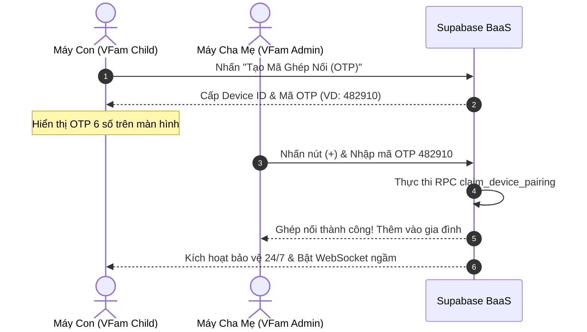

# 🛡️ Hướng Dẫn Triển Khai Thực Tế Hệ Thống MDM Parental Control (VFam)

Tài liệu này cung cấp toàn bộ quy trình từ A đến Z để triển khai thực tế hệ thống **VFam (Family Shield)** gồm 2 ứng dụng:
- **`VFam Child` (`target-node`)**: Ứng dụng cài trên máy con nắm đặc quyền tối cao **Android Device Owner (DO)**.
- **`VFam Admin` (`admin-node`)**: Ứng dụng cài trên máy phụ huynh (Flutter) dùng để giám sát và ra lệnh thời gian thực.
- **`Backend Supabase & Firebase FCM`**: Hệ thống máy chủ điều phối thời gian thực và kênh dự phòng đánh thức máy ngủ sâu.

---

## 📦 1. Chuẩn Bị Tệp Cài Đặt (Release Artifacts)

Phiên bản phát hành chính thức **`v1.1.0`** đã được đóng gói sẵn trong thư mục [`release/`](file:///d:/PROJECT/github.com/mdm-parental-control/release):
1. **Máy con**: [`release/vfam-child-1.1.0.apk`](file:///d:/PROJECT/github.com/mdm-parental-control/release/vfam-child-1.1.0.apk) (Package: `vn.hanoi.khuongnv.vfam.child`)
2. **Máy phụ huynh**: [`release/vfam-admin-1.1.0.apk`](file:///d:/PROJECT/github.com/mdm-parental-control/release/vfam-admin-1.1.0.apk) (Package: `vn.hanoi.khuongnv.vfam.admin`)
3. **Mã nguồn & Git Tag**: Đã đồng bộ tại Git Tag `v1.1.0` trên remote: [`https://github.com/khuongnv/mdm-parental-control`](https://github.com/khuongnv/mdm-parental-control)

---

## ☁️ 2. Chuẩn Bị Hạ Tầng Backend (Supabase & Firebase)

### 2.1. Cấu hình Supabase Database
1. Truy cập [Supabase Dashboard](https://supabase.com/dashboard) của dự án.
2. Mở mục **SQL Editor** -> Nhấn **New Query**.
3. Dán toàn bộ nội dung tệp [`backend/supabase/migrations/20261101_initial_schema.sql`](file:///d:/PROJECT/github.com/mdm-parental-control/backend/supabase/migrations/20261101_initial_schema.sql) và bấm **Run**.
4. Database sẽ tự động khởi tạo:
   - Các bảng: `families`, `family_members`, `devices`, `policies`, `app_rules`, `app_usage_logs`.
   - Các Stored Procedure (RPC): `create_device_pairing`, `claim_device_pairing`, `create_or_join_family`.
   - Bật tính năng Realtime Broadcast và Presence.

### 2.2. Cấu hình Firebase Cloud Messaging (FCM) cho Supabase Edge Function
1. Truy cập [Firebase Console](https://console.firebase.google.com) -> Dự án `mdm-parental-control`.
2. Vào **Cài đặt dự án (Project Settings)** ⚙️ -> Thẻ **Tài khoản dịch vụ (Service accounts)**.
3. Bấm **Tạo khóa riêng tư mới (Generate new private key)** -> Tải về file JSON.
4. Mở [Supabase Dashboard](https://supabase.com/dashboard) -> **Project Settings** -> **Edge Functions** -> **Secrets**:
   - Thêm Secret: `FIREBASE_SERVICE_ACCOUNT_JSON` với giá trị là toàn bộ nội dung tệp JSON vừa tải.
5. Triển khai Edge Function `send-fcm-command`:
   ```bash
   cd backend/supabase
   supabase functions deploy send-fcm-command
   ```

---

## 📱 3. Quy Trình Cài Đặt & Kích Hoạt Máy Con (`VFam Child`)

> [!IMPORTANT]
> **Yêu cầu quan trọng của Android Device Owner**:
> Để ứng dụng trở thành Device Owner (Bất khả xâm phạm, không thể gỡ cài đặt, tự động cấp quyền ngầm), máy con phải được thiết lập theo **1 trong 2 phương pháp** dưới đây.

### Phương Pháp 1: Kích hoạt nhanh bằng cáp USB qua máy tính (Khuyên Dùng khi thử nghiệm)
*Áp dụng khi máy con đang có sẵn dữ liệu và tài khoản Google.*

1. **Bật chế độ nhà phát triển trên máy con**:
   - Vào **Cài đặt (Settings)** -> **Thông tin điện thoại (About phone)** -> Chạm 7 lần liên tiếp vào **Số bản dựng (Build number)**.
   - Quay lại Cài đặt -> **Tùy chọn cho nhà phát triển (Developer options)** -> Bật **Gỡ lỗi USB (USB Debugging)**.
2. **Tạm thời xóa tài khoản Google / Mi / Samsung**:
   - *Lưu ý*: Android chỉ cho phép gán Device Owner khi thiết bị không có tài khoản người dùng cá nhân.
   - Vào **Cài đặt** -> **Tài khoản và sao lưu (Accounts)** -> Xóa tạm các tài khoản Google/Samsung/Xiaomi có trong máy. (Sau khi kích hoạt DO xong, bạn có thể đăng nhập lại bình thường).
3. **Cài đặt ứng dụng và gán đặc quyền Device Owner**:
   - Kết nối máy con với máy tính qua cáp USB, mở Terminal máy tính và chạy:
   ```bash
   # Cài đặt file APK máy con
   adb install -r release/vfam-child-1.1.0.apk

   # Gán quyền tối cao Device Owner cho VFam Child
   adb shell dpm set-device-owner vn.hanoi.khuongnv.vfam.child/com.mdm.parentalcontrol.child.receiver.MdmDeviceAdminReceiver
   ```
4. **Kiểm tra kết quả**:
   - Terminal xuất hiện thông báo:
     `Success: Device owner set to package vn.hanoi.khuongnv.vfam.child`
   - Trên thanh trạng thái máy con sẽ xuất hiện biểu tượng chiếc khiên hoặc dòng chữ: *"Thiết bị này được quản lý bởi tổ chức của bạn"*.

---

### Phương Pháp 2: Thiết lập máy mới hoặc vừa khôi phục cài đặt gốc (Zero-Touch Provisioning)
*Áp dụng khi mua máy mới cho con hoặc vừa Factory Reset máy.*

1. Tại màn hình chào mừng đầu tiên (**Welcome / Hi there**), **chạm liên tiếp 6 lần** vào khoảng trống bất kỳ trên màn hình.
2. Máy sẽ tự động bật camera quét mã QR.
3. Tạo mã QR chứa thông tin tải APK `vfam-child-1.1.0.apk` và quét:
   - Hệ thống sẽ tự động tải file APK, cài đặt ngầm và thiết lập quyền Device Owner ngay từ cấp hệ điều hành mà không cần máy tính.

---

## 👨‍👩‍👧 4. Cài Đặt Ứng Dụng Phụ Huynh (`VFam Admin`)

1. Chuyển tệp [`release/vfam-admin-1.1.0.apk`](file:///d:/PROJECT/github.com/mdm-parental-control/release/vfam-admin-1.1.0.apk) sang điện thoại của Bố/Mẹ (qua Zalo, Google Drive hoặc kết nối cáp).
2. Nhấn vào tệp APK để cài đặt.
3. Cho phép quyền cài đặt ứng dụng từ nguồn ngoài nếu được hỏi.
4. Mở ứng dụng **VFam Admin** có biểu tượng khiên xanh sang trọng.

---

## 🔗 5. Quy Trình Ghép Nối Thiết Bị (Device Pairing)



1. **Trên máy con**:
   - Mở ứng dụng **VFam Child**.
   - Màn hình hiển thị: *"🛡️ Trạng thái: DEVICE OWNER ĐÃ KÍCH HOẠT"*.
   - Nhấn nút: **`✨ Tạo Mã Ghép Nối Với Phụ Huynh (OTP)`**.
   - Màn hình sẽ hiển thị mã OTP 6 số (Ví dụ: `👉 OTP: [ 839201 ]`).
2. **Trên máy phụ huynh**:
   - Mở ứng dụng **VFam Admin**.
   - Nhấn vào biểu tượng **`+`** ở góc trên thanh công cụ (AppBar).
   - Nhập mã 6 số đang hiện trên máy con và nhấn **Ghép Nối**.
   - **Hoàn tất**: Thiết bị con sẽ lập tức xuất hiện trên Dashboard của phụ huynh với trạng thái Online!

---

## 🎮 6. Thử Nghiệm Các Tính Năng Quản Lý Thực Tế

### 6.1. Thử nghiệm Khóa Khẩn Cấp (Instant Panic Lockdown)
- **Thao tác**: Trên Dashboard app phụ huynh, gạt công tắc **Khóa Khẩn Cấp** sang trạng thái Bật.
- **Hiện tượng trên máy con (< 1-2 giây)**:
  - Toàn bộ các icon ứng dụng giải trí (Youtube, Game, Facebook, TikTok...) trên màn hình chính của máy con sẽ **bị làm xám (grayed-out)**.
  - Khi trẻ cố tình nhấn mở, hệ điều hành Android sẽ hiện hộp thoại thông báo chuẩn: *"Ứng dụng đã bị quản trị viên tạm dừng"*.
  - Các ứng dụng thiết yếu (Gọi điện thoại khẩn cấp, Cài đặt hệ thống, Bản đồ cấp cứu) vẫn hoạt động bình thường theo chuẩn Zero-Bypass.

### 6.2. Thử nghiệm Thưởng Thêm Giờ (+15m, +30m)
- **Thao tác**: Phụ huynh nhấn vào nút **+15m** hoặc **+30m** trên Dashboard.
- **Hiện tượng trên máy con**:
  - Hạn mức sử dụng trong ngày được tự động cộng thêm.
  - Các ứng dụng đang bị khóa do hết quota sẽ tự động mở sáng trở lại lập tức.

### 6.3. Thử nghiệm Đánh Thức Ngủ Sâu qua Firebase (Doze Mode Test)
- **Thử nghiệm**: Tắt màn hình máy con, để nguyên trong 5 phút để Android đưa máy vào Doze Mode.
- **Thao tác**: Phụ huynh kích hoạt lệnh khóa từ xa.
- **Hiện tượng**: Bản tin FCM High-Priority Data message lập tức đánh thức CPU máy con và áp đặt lệnh khóa `setPackagesSuspended` ngay cả khi màn hình đang tắt.

---

## 🔧 7. Bảng Lệnh ADB Hữu Ích & Khắc Phục Sự Cố (Troubleshooting)

| Tình huống | Lệnh ADB / Cách xử lý |
| :--- | :--- |
| **Kiểm tra trạng thái Device Owner** | `adb shell dpm list-owners` (Kết quả phải có `vn.hanoi.khuongnv.vfam.child`) |
| **Xem log realtime của máy con** | `adb logcat -s MdmChildApp UsageTrackingService MdmFCMService MdmDeviceAdmin` |
| **Lỗi `Not allowed to set the device owner because there are already some accounts on the device`** | Vào Cài đặt máy con -> Tài khoản -> Xóa hết tài khoản Google/Samsung/Xiaomi rồi chạy lại lệnh set-device-owner. |
| **Lỗi `Device already provisioned`** | Máy đã hoàn tất setup wizard. Chỉ cần đảm bảo đã xóa tài khoản cá nhân như trên là lệnh ADB sẽ thành công. |
| **Gỡ cài đặt Device Owner khi cần trả máy / bảo hành** | Chạy lệnh: `adb shell dpm remove-active-admin vn.hanoi.khuongnv.vfam.child/com.mdm.parentalcontrol.child.receiver.MdmDeviceAdminReceiver` sau đó gỡ app bình thường bằng `adb uninstall vn.hanoi.khuongnv.vfam.child`. |

---

## 🏆 8. Tổng Kết
Hệ thống **VFam Parental Control** đã hoàn thiện toàn bộ chu trình kỹ thuật:
- ✅ **Bảo mật tuyệt đối**: Khóa tầng sâu HĐH bằng API Device Owner chuẩn của Google.
- ✅ **Điều khiển tức thì**: Phản hồi qua Supabase WebSocket & Firebase High-Priority Push.
- ✅ **Trải nghiệm thân thiện**: Nhận diện thương hiệu ấm áp, bảo vệ con cái an toàn và tin cậy.
