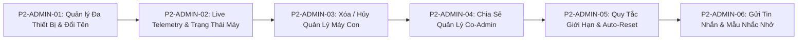

# 📱 EPICS CHI TIẾT GIAI ĐOẠN 2: ADMIN-NODE (PARENT MANAGEMENT APP)

- **Thành phần**: `admin-node` (Ứng dụng Di động Phụ Huynh - Flutter)
- **Thiết kế UI/UX**: Apple Music / iOS Human Interface Guidelines (Dark AMOLED & Light Theme, SF Pro / System Font Native)
- **Agent phụ trách**: `parent-ui-specialist`
- **Mục tiêu**: Nâng cấp toàn diện ứng dụng Phụ huynh với năng lực quản lý linh hoạt nhiều máy, theo dõi trạng thái sống động thời gian thực, phân quyền gia đình, cấu hình quy tắc hạn mức tự động reset và tương tác 2 chiều mượt mà với con trẻ.

---

## 📑 Danh Mục Epics Giai Đoạn 2 (Admin Node)

---

## 📌 P2-ADMIN-01: Quản Lý Nhiều Thiết Bị Con & Đổi Tên Gợi Nhớ (Multi-Device Management & Custom Naming)

### 1. Bối cảnh & Vấn đề hiện tại
- Hiện tại Admin App chỉ lưu trữ và hiển thị 1 thiết bị đơn lẻ (`currentDeviceId`). Trong một gia đình thực tế, phụ huynh thường có từ 2 đến 3 con, mỗi con có thể sở hữu điện thoại hoặc máy tính bảng riêng.
- Tên thiết bị ban đầu mặc định là tên model phần cứng (ví dụ: `Samsung SM-X200`, `Xiaomi 2201117TY`), rất khó phân biệt máy nào là của ai.

### 2. User Stories & Nhiệm Vụ Chi Tiết
#### US 1.1: Thanh Chọn Thiết Bị Con Linh Hoạt (Device Selector Carousel / Pill Bar)
- **Giao diện**: Thanh trượt ngang (Horizontal Carousel) đặt ở đầu màn hình Dashboard.
- **Hiển thị**: Mỗi thiết bị con được hiển thị dưới dạng Card/Chip bo góc tròn chuẩn Apple:
  - Avatar đại diện bé kèm badge màu nhận diện.
  - Tên gợi nhớ của máy con (ví dụ: `Bé Bi - Galaxy Tab`).
  - Chấm màu trạng thái kết nối (`🟢 Trực tuyến`, `⚪ Ngoại tuyến`, `🔴 Bị Khóa`).
  - Nút `+ Thêm thiết bị` ở cuối danh sách để mở nhanh trình quét QR/nhập OTP ghép nối máy mới.
- **Thao tác**: Chạm vào máy nào, toàn bộ dữ liệu Dashboard (Screen time, App limits, Live status, Panic Lock) chuyển sang máy đó ngay lập tức với animation chuyển cảnh mượt mà.

#### US 1.2: Chức Năng Đổi Tên Thiết Bị (Rename Device / Custom Alias)
- **Giao diện**: Nút icon chỉnh sửa ✏️ cạnh tên thiết bị hoặc trong menu Cài đặt thiết bị (Device Settings Sheet).
- **Thao tác**:
  - Mở Cupertino Action Sheet / Dialog cho phép phụ huynh nhập tên mới (ví dụ: `Điện thoại Tí`, `Máy tính bảng Na học bài`).
  - Giới hạn độ dài: 1 - 30 ký tự, tự động cắt khoảng trắng thừa.
  - Nút lưu "Cập nhật tên": Cập nhật cột `custom_name` trên bảng `devices` trong Supabase thông qua RPC hoặc PATCH request.
- **Cập nhật tức thời (Optimistic UI)**:
  - Tên đổi ngay trên UI phụ huynh không cần tải lại trang.
  - Gửi broadcast sự kiện `DEVICE_RENAMED` qua Supabase Channel để đồng bộ sang các máy phụ huynh khác (Co-admin) và máy con.

### 3. Tiêu Chuẩn Nghiệm Thu (Acceptance Criteria)
- [ ] Phụ huynh có thể ghép nối từ 2 thiết bị trở lên vào cùng một tài khoản gia đình.
- [ ] Chuyển đổi giữa các thiết bị trên Dashboard với độ trễ < 300ms.
- [ ] Đổi tên thiết bị thành công, lưu bền vững vào database và phản ánh ngay lập tức trên UI.
- [ ] Hỗ trợ đầy đủ tiếng Việt có dấu.

---

## 📌 P2-ADMIN-02: Hiển Thị Trạng Thái Telemetry & Live Status Chuẩn Xác

### 1. Bối cảnh & Vấn đề hiện tại
- Trạng thái trực tuyến hiện nay đôi khi bị chậm trễ hoặc không phân biệt rõ ràng giữa "Mất kết nối mạng", "Đang khóa máy" hay "Màn hình đang tắt".
- Phụ huynh cần biết chính xác: Bé có đang dùng máy không, đang mở app gì, pin còn bao nhiêu để kịp nhắc nhở cắm sạc.

### 2. User Stories & Nhiệm Vụ Chi Tiết
#### US 2.1: Thẻ Trạng Thái Kết Nối & Hoạt Động Thời Gian Thực (Live Presence Badge)
- **Nguồn dữ liệu**: Kết hợp **Supabase Realtime Presence** (`state: online/offline`) và trường `last_seen_at` từ cơ sở dữ liệu.
- **Phân loại trạng thái chuẩn**:
  - `🟢 Trực tuyến (Đang hoạt động)`: Máy con đang mở màn hình và duy trì kết nối WebSocket.
  - `🟡 Màn hình tắt (Chế độ chờ)`: Kết nối vẫn duy trì nhưng màn hình đang tắt (Deep Sleep).
  - `🔴 Đang bị Khóa (Lockdown)`: Thiết bị đang trong trạng thái khóa khẩn cấp hoặc hết hạn mức.
  - `🟣 Giờ Đi Ngủ (Bedtime Mode)`: Thiết bị tự động khóa do nằm trong khung giờ giới nghiêm ban đêm.
  - `⚪ Ngoại tuyến (Offline)`: Mất kết nối internet > 60 giây. Kèm dòng phụ: `"Lần cuối online: 15 phút trước"`.

#### US 2.2: Hiển Thị Ứng Dụng Đang Mở & Mức Pin (Foreground App & Battery Status)
- **Tên app đang mở**: Hiển thị nhãn thông tin sinh động (ví dụ: `Đang mở: Duolingo Học Tiếng Anh` hoặc `Đang ở: Màn hình chính`).
  - Nếu app đang mở là một app giải trí sắp hết quota, đổi badge sang màu cam cảnh báo.
- **Chỉ số Pin & Sạc**:
  - Icon pin trực quan hiển thị % pin hiện tại (ví dụ: `🔋 68%`).
  - Biểu tượng tia sét ⚡ khi máy con đang cắm sạc.
  - Nếu pin < 15%: Cảnh báo màu đỏ `"Pin yếu: 12% - Cần sạc máy"`.

#### US 2.3: Thanh Tiến Độ Quota Động Hôm Nay (Accurate Screen Time Progress)
- Hiển thị song song: Thời gian đã dùng / Hạn mức cho phép / Thời gian còn lại (ví dụ: `Đã dùng 1h 15m / Hạn mức 2h 00m - Còn lại 45m`).
- Tự động cộng/trừ các khoản thời gian thưởng hoặc phạt thêm ngay trên thanh tiến độ.

### 3. Tiêu Chuẩn Nghiệm Thu (Acceptance Criteria)
- [ ] Trạng thái kết nối phản hồi chính xác khi máy con bật/tắt mạng trong vòng 3 - 5 giây.
- [ ] Hiển thị đúng tên app đang chạy ở Foreground (cập nhật từ telemetry của máy con).
- [ ] Cập nhật chính xác mức pin và trạng thái sạc.

---

## 📌 P2-ADMIN-03: Hủy Quản Lý & Xóa Thiết Bị (Device Revocation & Unpairing)

### 1. Bối cảnh & Vấn đề hiện tại
- Khi trẻ đổi điện thoại mới, bán máy cũ hoặc khi phụ huynh không muốn quản lý thiết bị đó nữa, hiện chưa có luồng unpair an toàn khiến dữ liệu máy con vẫn bị ràng buộc vào gia đình.

### 2. User Stories & Nhiệm Vụ Chi Tiết
#### US 3.1: Giao Diện Hủy Quản Lý Thiết Bị (Unpair Action Sheet)
- **Vị trí**: Nằm trong trang `Chi tiết thiết bị` -> Khu vực nguy hiểm (Danger Zone) ở cuối trang.
- **Nút hành động**: Nút đỏ `"Hủy quản lý thiết bị này"` (Unpair Device).
- **Hộp thoại xác nhận 2 bước**:
  - Bước 1: Popup cảnh báo rõ hậu quả: *"Toàn bộ chính sách giới hạn trên máy này sẽ bị gỡ bỏ, dữ liệu liên kết sẽ được dọn dẹp. Bạn có chắc chắn muốn tiếp tục?"*.
  - Bước 2: Yêu cầu xác thực sinh trắc học (Vân tay/Face ID) hoặc nhập mật khẩu phụ huynh để ngăn người khác nghịch máy xóa nhầm.

#### US 3.2: Thực Thi Lệnh Xóa Đa Tầng (Multi-Tier Unpair Execution)
- **Phía Backend**:
  - Gọi Stored Procedure `revoke_device_management(p_device_id, p_family_id)`.
  - Cập nhật trạng thái máy con thành `status = 'revoked'`, gỡ `family_id = NULL`.
  - Phát broadcast sự kiện `DEVICE_UNPAIRED` tới kênh `realtime:device:{deviceId}`.
- **Phía Máy Con (`target-node`)**:
  - Nhận sự kiện `DEVICE_UNPAIRED`:
    - Xóa `familyId`, đưa cờ `isPaired = false`.
    - Gỡ bỏ toàn bộ suspension trên các ứng dụng (Unsuspend all apps).
    - Mở lại màn hình ban đầu (Chờ tạo mã ghép nối mới).
- **Phía Phụ Huynh (`admin-node`)**:
  - Xóa thiết bị khỏi danh sách chọn trên Dashboard.
  - Tự động chuyển tiêu điểm sang thiết bị con còn lại trong gia đình (hoặc màn hình trống nếu không còn máy nào).

### 3. Tiêu Chuẩn Nghiệm Thu (Acceptance Criteria)
- [ ] Có bước xác nhận bảo mật nghiêm ngặt trước khi xóa.
- [ ] Gửi lệnh hủy thành công xuống máy con qua WebSocket/FCM.
- [ ] Máy con tự động mở khóa mọi ứng dụng và trở về trạng thái chưa ghép nối.
- [ ] Danh sách thiết bị trên máy phụ huynh được cập nhật sạch sẽ ngay lập tức.

---

## 📌 P2-ADMIN-04: Chia Sẻ Quyền Quản Lý Cho Admin Khác (Co-Admin Family Sharing)

### 1. Bối cảnh & Vấn đề hiện tại
- Thông thường trong gia đình cả Bố và Mẹ đều cần giám sát con. Hiện tại hệ thống chỉ gắn thiết bị vào tài khoản tạo ban đầu, khiến phụ huynh thứ 2 không thể cùng xem và điều khiển.

### 2. User Stories & Nhiệm Vụ Chi Tiết
#### US 4.1: Danh Sách Thành Viên Phụ Huynh (Family Co-Admin Roster)
- **Vị trí**: Tab Cài Đặt -> Mục "Thành viên gia đình" (Family Members).
- **Hiển thị danh sách**:
  - `Chủ hộ (Owner)`: Người tạo gia đình ban đầu, có toàn quyền thêm/xóa phụ huynh khác.
  - `Đồng quản trị viên (Co-parent)`: Phụ huynh được mời, có quyền xem báo cáo, đặt hạn mức, khóa khẩn cấp và duyệt xin giờ, nhưng không thể xóa Owner.

#### US 4.2: Luồng Mời Phụ Huynh Thứ Hai Bằng Mã Mời Hoặc QR (Invite Flow)
- **Tạo lời mời**:
  - Owner bấm nút `+ Mời phụ huynh cùng quản lý`.
  - Hệ thống gọi RPC `create_family_invite` sinh ra:
    - Một mã mời gồm 6 ký tự chữ và số (ví dụ: `FAM-892K`, TTL 24 giờ).
    - Mã QR Code lời mời để phụ huynh thứ hai quét trực tiếp bằng camera.
    - Nút "Sao chép lời mời" để gửi qua Zalo / Tin nhắn.
- **Gia nhập gia đình**:
  - Trên điện thoại phụ huynh thứ 2: Mở app, tại màn hình đăng nhập hoặc Cài đặt chọn "Tham gia gia đình có sẵn".
  - Quét mã QR hoặc nhập mã 6 số.
  - Hệ thống xác thực và thêm phụ huynh thứ 2 vào bảng `family_members` với quyền `parent`.
  - Danh sách toàn bộ máy con của gia đình lập tức xuất hiện trên máy phụ huynh thứ 2.

#### US 4.3: Đồng Bộ Hoạt Động Giữa Các Phụ Huynh
- Khi Bố bấm "Cộng 30 phút", máy Mẹ cũng lập tức nhận được thông báo cập nhật trạng thái mới.
- Khi con gửi yêu cầu xin giờ, cả 2 máy Bố và Mẹ đều nhận thông báo. Khi một người duyệt, máy còn lại hiển thị `"Đã được Bố duyệt lúc 19:30"`.

### 3. Tiêu Chuẩn Nghiệm Thu (Acceptance Criteria)
- [ ] Tạo mã mời 6 số và mã QR thành công, có thời hạn hiệu lực 24h.
- [ ] Phụ huynh thứ 2 nhập mã hoặc quét QR được gia nhập gia đình ngay lập tức.
- [ ] Cả 2 phụ huynh cùng nhìn thấy dữ liệu máy con đồng nhất qua Supabase Realtime.
- [ ] Chủ hộ (Owner) có thể thu hồi quyền của Co-Admin bất kỳ lúc nào.

---

## 📌 P2-ADMIN-05: Cấu Hình Giới Hạn Giờ (Quy Tắc Ngày / Tuần & Tự Động Reset)

### 1. Bối cảnh & Vấn đề hiện tại
- Phụ huynh muốn có sự linh hoạt: Có gia đình thích quản lý theo ngày (mặc định 2 giờ/ngày), có gia đình muốn khoán theo tuần (14 giờ/tuần) để rèn tính tự chủ cho con.
- Vấn đề cốt lõi: Khi qua ngày mới (sau 00:00:00), hệ thống bắt buộc phải **tự động reset thời gian sử dụng về 0**, đồng thời **reset hạn mức về giá trị mặc định đã cài đặt** (loại bỏ các giờ thưởng/phạt tạm thời của ngày hôm trước).

### 2. User Stories & Nhiệm Vụ Chi Tiết
#### US 5.1: Bộ Chuyển Đổi Quy Tắc Hạn Mức (Rule Type Segmented Switcher)
- Giao diện chuyển đổi 2 chế độ rõ ràng:
  - `Theo Ngày (Daily Mode)` *(Mặc định)*.
  - `Theo Tuần (Weekly Mode)`.

#### US 5.2: Cấu Hình Hạn Mức Theo Ngày (Daily Rule Configuration)
- **Hạn mức chuẩn**: Mặc định là **2 giờ (120 phút)** khi mới ghép nối.
- **Thanh trượt tùy chỉnh (Custom Slider)**:
  - Cho phép điều chỉnh từ 15 phút đến 8 tiếng (bước nhảy 15 phút).
  - Có thể cấu hình tách biệt:
    - **Ngày trong tuần (Thứ 2 - Thứ 6)**: ví dụ 1h 30m.
    - **Cuối tuần (Thứ 7 & Chủ Nhật)**: ví dụ 3h 00m.
- **Quy tắc Reset Hàng Ngày (Auto-Reset Contract)**:
  - Đúng `00:00:00` theo múi giờ thiết bị con:
    - Thời gian đã sử dụng trong ngày (`used_minutes`) tự động đặt lại bằng `0`.
    - Hạn mức của ngày hôm đó trở về đúng giá trị chuẩn cấu hình (ví dụ 120 phút).
    - Các giá trị thưởng (`extra_time_minutes`) hoặc phạt cộng dồn của ngày cũ được giải phóng hoàn toàn.
    - Nếu máy con đang bị suspend do hết giờ hôm qua, hệ thống tự động gỡ bỏ khóa (Un-suspend) lúc 00:00 (trừ trường hợp đang trong khung giờ Đi Ngủ - Bedtime).

#### US 5.3: Cấu Hình Hạn Mức Theo Tuần (Weekly Rule Configuration)
- Đặt tổng quỹ thời gian cho cả tuần (ví dụ: 14 giờ/tuần).
- Đặt trần tối đa mỗi ngày (Daily Cap, ví dụ tối đa 3h/ngày) để tránh trẻ dùng hết sạch thời gian tuần ngay trong Thứ Hai.
- Cơ chế reset: Quỹ tuần tự động reset về đầy đủ vào `00:00:00` sáng Thứ Hai hàng tuần.

### 3. Tiêu Chuẩn Nghiệm Thu (Acceptance Criteria)
- [ ] Chuyển đổi mượt mà giữa chế độ Ngày và Tuần.
- [ ] Giá trị hạn mức mặc định luôn là 120 phút (2 giờ) và có thể điều chỉnh linh hoạt.
- [ ] Sau 00:00:00, thời gian đã dùng tự động về 0, hạn mức trở về giá trị gốc.
- [ ] Lưu cấu hình bền vững vào bảng `policies` và đồng bộ tức thời xuống máy con qua WebSocket.

---

## 📌 P2-ADMIN-06: Gửi Tin Nhắn Nhắc Nhở & Mẫu Câu Nhanh (Remote Messaging & Quick Reminders)

### 1. Bối cảnh & Vấn đề hiện tại
- Khi thấy con đang dùng máy quá lâu hoặc đến giờ sinh hoạt gia đình, phụ huynh thường phải đi tìm hoặc gọi lớn tiếng. Cần có công cụ gửi thông điệp nhẹ nhàng, văn minh trực tiếp lên màn hình máy con.

### 2. User Stories & Nhiệm Vụ Chi Tiết
#### US 6.1: Giao Diện Gửi Tin Nhắn Nhanh (Send Reminder Sheet)
- **Vị trí**: Nút icon chuông 🔔 hoặc tin nhắn 💬 trên thẻ thiết bị con tại Dashboard.
- **Trình bày**: Bottom Sheet chuẩn Apple bo tròn 28px, hiệu ứng kính mờ (Frosted Glass).

#### US 6.2: Danh Sách Mẫu Câu Nhắc Nhở Có Sẵn (Quick Preset Chips)
Cung cấp các thẻ mẫu kèm icon sinh động, chạm là chọn ngay:
1. 🍚 **Giờ ăn cơm**: *"Đến giờ ăn cơm rồi con ơi, cất máy vào bàn nhé!"*
2. 📚 **Học bài thôi**: *"Nghỉ mắt một chút rồi chuẩn bị ngồi vào bàn học nào con!"*
3. 🛏️ **Giờ đi ngủ**: *"Đã muộn rồi, cất máy đi sạc và chuẩn bị đi ngủ thôi con yêu!"*
4. ⏱️ **Cảnh báo tắt máy**: *"Ba mẹ cho con thêm 5 phút nữa để lưu game và tắt máy nhé!"*
5. 🧹 **Làm việc nhà**: *"Con đã dọn phòng và phụ ba mẹ việc nhà chưa nào?"*
6. 🏃 **Vận động ngoài trời**: *"Hôm nay trời đẹp, ra ngoài vận động một chút đi con!"*

#### US 6.3: Ô Nhập Tin Nhắn Tùy Chỉnh (Custom Message Input)
- Phụ huynh có thể tự gõ nội dung tùy ý (tối đa 150 ký tự).
- Đếm số ký tự còn lại theo thời gian thực.
- Nút bấm lớn màu đỏ Apple Music: `"Gửi Nhắc Nhở Ngay"`.

#### US 6.4: Truyền Tin Tức Thì & Báo Nhận (Realtime Delivery & ACK)
- Phát broadcast event `REMOTE_MESSAGE` tới kênh Supabase `realtime:device:{deviceId}` với độ trễ < 500ms.
- Hiển thị trạng thái gửi:
  - `Đang gửi...` 🔄
  - `Đã gửi tới máy con` 📤
  - `Bé đã bấm xác nhận "Dạ con nghe rồi"` ✅ (kèm mốc thời gian nhận).

### 3. Tiêu Chuẩn Nghiệm Thu (Acceptance Criteria)
- [ ] Có đầy đủ 6 mẫu nhắc nhở nhanh thông dụng và ô nhập văn bản tự do.
- [ ] Gửi lệnh xuống máy con thành công qua Realtime WebSocket / FCM trong < 1.5 giây.
- [ ] Hiển thị phản hồi xác nhận (ACK) khi bé nhấn vào thông báo trên máy con.
