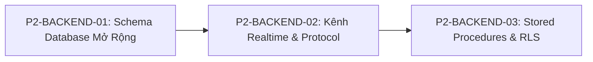

# ☁️ EPICS CHI TIẾT GIAI ĐOẠN 2: BACKEND & SUPABASE (DATA CONTRACTS & REALTIME)

- **Thành phần**: `backend` (Supabase BaaS / PostgreSQL 15+ / Realtime Engine / Edge Functions)
- **Agent phụ trách**: `backend-sync-specialist` & `lead-architect`
- **Mục tiêu**: Cung cấp tầng dữ liệu, Stored Procedures, kênh truyền Realtime Broadcast và phân quyền Row Level Security (RLS) để làm xương sống cho toàn bộ các tính năng Giai đoạn 2: Quản lý đa thiết bị, chia sẻ gia đình Co-Admin, duyệt xin giờ, gửi tin nhắn nhắc nhở và cập nhật hạn mức động.

---

## 📑 Danh Mục Epics Giai Đoạn 2 (Backend Supabase)



---

## 📌 P2-BACKEND-01: Lược Đồ Dữ Liệu & Migration Supabase Mở Rộng

### 1. Bổ sung các cột mới trên bảng hiện hữu

#### 1.1. Bảng `public.devices`
```sql
ALTER TABLE public.devices
    ADD COLUMN IF NOT EXISTS custom_name TEXT, -- Tên gợi nhớ do phụ huynh đặt (vd: "Điện thoại Bé Bi")
    ADD COLUMN IF NOT EXISTS battery_level INT DEFAULT 100, -- Mức pin hiện tại (0 - 100%)
    ADD COLUMN IF NOT EXISTS is_charging BOOLEAN DEFAULT false, -- Trạng thái sạc pin
    ADD COLUMN IF NOT EXISTS current_app_name TEXT DEFAULT 'Màn hình chính', -- Tên app đang mở
    ADD COLUMN IF NOT EXISTS current_package_name TEXT, -- Package name đang mở
    ADD COLUMN IF NOT EXISTS is_unpaired BOOLEAN DEFAULT false; -- Đánh dấu đã bị hủy quản lý
```

#### 1.2. Bảng `public.policies`
```sql
ALTER TABLE public.policies
    ADD COLUMN IF NOT EXISTS rule_type TEXT NOT NULL DEFAULT 'daily' CHECK (rule_type IN ('daily', 'weekly')),
    ADD COLUMN IF NOT EXISTS weekly_screen_time_limit_mins INT NOT NULL DEFAULT 840, -- 14 giờ/tuần
    ADD COLUMN IF NOT EXISTS weekday_limits JSONB NOT NULL DEFAULT '{"mon": 120, "tue": 120, "wed": 120, "thu": 120, "fri": 120, "sat": 180, "sun": 180}'::jsonb,
    ADD COLUMN IF NOT EXISTS auto_reset_hour INT NOT NULL DEFAULT 0; -- Giờ reset hàng ngày (0 = 00:00:00)
```

---

### 2. Các bảng mới phục vụ Nghiệp vụ Giai đoạn 2

#### 2.1. Bảng `public.family_invites` (Mã mời Co-Admin)
Quản lý các mã mời 6 ký tự để chia sẻ quyền quản lý gia đình cho phụ huynh thứ 2:
```sql
CREATE TABLE IF NOT EXISTS public.family_invites (
    id UUID PRIMARY KEY DEFAULT gen_random_uuid(),
    family_id UUID NOT NULL REFERENCES public.families(id) ON DELETE CASCADE,
    invite_code VARCHAR(8) NOT NULL UNIQUE, -- Mã mời (ví dụ: FAM-892K)
    created_by UUID NOT NULL REFERENCES auth.users(id) ON DELETE CASCADE,
    role TEXT NOT NULL DEFAULT 'parent' CHECK (role IN ('parent', 'viewer')),
    expires_at TIMESTAMPTZ NOT NULL, -- TTL 24 giờ
    is_used BOOLEAN NOT NULL DEFAULT false,
    used_by UUID REFERENCES auth.users(id) ON DELETE SET NULL,
    created_at TIMESTAMPTZ NOT NULL DEFAULT now()
);

CREATE INDEX IF NOT EXISTS idx_family_invites_code ON public.family_invites(invite_code) WHERE is_used = false;
```

#### 2.2. Bảng `public.time_requests` (Yêu cầu xin thêm giờ của con)
Lưu trữ và theo dõi toàn bộ các yêu cầu xin thêm thời gian từ máy con:
```sql
CREATE TABLE IF NOT EXISTS public.time_requests (
    id UUID PRIMARY KEY DEFAULT gen_random_uuid(),
    device_id UUID NOT NULL REFERENCES public.devices(id) ON DELETE CASCADE,
    family_id UUID NOT NULL REFERENCES public.families(id) ON DELETE CASCADE,
    requested_minutes INT NOT NULL CHECK (requested_minutes > 0),
    reason TEXT NOT NULL DEFAULT 'Chưa xong bài tập',
    status TEXT NOT NULL DEFAULT 'pending' CHECK (status IN ('pending', 'approved', 'rejected', 'expired')),
    resolved_by UUID REFERENCES auth.users(id) ON DELETE SET NULL,
    resolved_minutes INT DEFAULT 0, -- Số phút thực tế được duyệt
    created_at TIMESTAMPTZ NOT NULL DEFAULT now(),
    resolved_at TIMESTAMPTZ
);

CREATE INDEX IF NOT EXISTS idx_time_requests_device ON public.time_requests(device_id, status);
CREATE INDEX IF NOT EXISTS idx_time_requests_family ON public.time_requests(family_id, status);
```

#### 2.3. Bảng `public.device_messages` (Tin nhắn & Mẫu nhắc nhở phụ huynh gửi con)
```sql
CREATE TABLE IF NOT EXISTS public.device_messages (
    id UUID PRIMARY KEY DEFAULT gen_random_uuid(),
    device_id UUID NOT NULL REFERENCES public.devices(id) ON DELETE CASCADE,
    family_id UUID NOT NULL REFERENCES public.families(id) ON DELETE CASCADE,
    sender_id UUID NOT NULL REFERENCES auth.users(id) ON DELETE CASCADE,
    template_key TEXT, -- 'dinner', 'study', 'bedtime', 'tidy', 'warning', 'custom'
    message_text TEXT NOT NULL,
    is_acknowledged BOOLEAN NOT NULL DEFAULT false,
    acknowledged_at TIMESTAMPTZ,
    sent_at TIMESTAMPTZ NOT NULL DEFAULT now()
);

CREATE INDEX IF NOT EXISTS idx_device_messages_device ON public.device_messages(device_id, sent_at DESC);
```

---

## 📌 P2-BACKEND-02: Kênh Realtime Broadcast, Presence & Event Protocol

Hệ thống sử dụng **Phoenix Channels Protocol** thông qua Supabase Realtime với 2 kênh chính:

### 1. Kênh Thiết Bị: `realtime:device:{deviceId}`
Dùng cho giao tiếp trực tiếp 1-1 giữa Phụ huynh và một máy con cụ thể.

#### 1.1. Event: `REMOTE_MESSAGE` (Phụ huynh -> Máy con)
```json
{
  "event": "REMOTE_MESSAGE",
  "payload": {
    "message_id": "c1f7b8d4-59e2-4c28-9844-301389e92a2a",
    "sender_name": "Mẹ",
    "template_key": "dinner",
    "title": "🍚 Đến giờ ăn cơm rồi con ơi!",
    "body": "Đến giờ ăn cơm rồi con ơi, cất máy vào bàn nhé!",
    "timestamp": 1793526000000
  }
}
```

#### 1.2. Event: `ACK_MESSAGE` (Máy con -> Phụ huynh)
```json
{
  "event": "ACK_MESSAGE",
  "payload": {
    "message_id": "c1f7b8d4-59e2-4c28-9844-301389e92a2a",
    "device_id": "787c8801-b580-4824-8141-9a7442ca65f7",
    "status": "acknowledged",
    "timestamp": 1793526012000
  }
}
```

#### 1.3. Event: `ADJUST_SCREEN_TIME` (Phụ huynh -> Máy con: Thưởng/Phạt động)
```json
{
  "event": "ADJUST_SCREEN_TIME",
  "payload": {
    "delta_minutes": 30, // Dương: Thưởng (+15, +30, +60). Âm: Phạt (-15, -30)
    "reason": "Hoàn thành bài tập xuất sắc",
    "sender_name": "Bố",
    "timestamp": 1793526100000
  }
}
```

#### 1.4. Event: `DEVICE_UNPAIRED` (Phụ huynh -> Máy con: Hủy quản lý)
```json
{
  "event": "DEVICE_UNPAIRED",
  "payload": {
    "device_id": "787c8801-b580-4824-8141-9a7442ca65f7",
    "reason": "Phụ huynh đã hủy quản lý thiết bị này",
    "timestamp": 1793526200000
  }
}
```

---

### 2. Kênh Gia Đình: `realtime:family:{familyId}`
Dùng cho broadcast toàn bộ các máy trong gia đình (đồng bộ giữa Bố và Mẹ).

#### 2.1. Event: `TIME_REQUEST` (Máy con -> Toàn bộ Phụ huynh)
```json
{
  "event": "TIME_REQUEST",
  "payload": {
    "request_id": "90d1e34b-118f-490b-ba62-38b4df53723f",
    "device_id": "787c8801-b580-4824-8141-9a7442ca65f7",
    "device_name": "Điện thoại Bé Bi",
    "requested_minutes": 30,
    "reason": "Con đang xem nốt bài giảng tiếng Anh",
    "created_at": "2026-11-02T19:30:00Z"
  }
}
```

#### 2.2. Event: `TIME_REQUEST_RESOLVED` (Phụ huynh -> Máy con & Phụ huynh khác)
```json
{
  "event": "TIME_REQUEST_RESOLVED",
  "payload": {
    "request_id": "90d1e34b-118f-490b-ba62-38b4df53723f",
    "device_id": "787c8801-b580-4824-8141-9a7442ca65f7",
    "status": "approved", // 'approved' hoặc 'rejected'
    "granted_minutes": 30,
    "resolved_by_name": "Bố",
    "timestamp": 1793526300000
  }
}
```

#### 2.3. Presence Metadata Protocol (Máy con duy trì Presence)
```json
{
  "status": "online",
  "device_id": "787c8801-b580-4824-8141-9a7442ca65f7",
  "battery_level": 82,
  "is_charging": false,
  "current_app": "Duolingo",
  "timestamp": 1793526400000
}
```

---

## 📌 P2-BACKEND-03: Stored Procedures (RPC) & Row Level Security (RLS)

### 1. Stored Procedures Cốt Lõi

#### 1.1. `create_family_invite`: Tạo mã mời Co-Admin 6 số
```sql
CREATE OR REPLACE FUNCTION public.create_family_invite(
    p_family_id UUID,
    p_role TEXT DEFAULT 'parent'
)
RETURNS JSONB AS $$
DECLARE
    v_code VARCHAR(8);
    v_invite_id UUID;
BEGIN
    -- Kiểm tra người gọi phải là Owner hoặc Parent của Family
    IF NOT EXISTS (
        SELECT 1 FROM public.family_members
        WHERE family_id = p_family_id AND user_id = auth.uid()
    ) THEN
        RAISE EXCEPTION 'Không có quyền tạo lời mời cho gia đình này';
    END IF;

    -- Sinh mã ngẫu nhiên dạng FAM-XXXX (chữ hoa và số, tránh ký tự dễ nhầm)
    v_code := 'FAM-' || upper(substring(replace(encode(gen_random_bytes(4), 'base64'), '/', 'X') from 1 for 4));

    INSERT INTO public.family_invites (family_id, invite_code, created_by, role, expires_at)
    VALUES (p_family_id, v_code, auth.uid(), p_role, now() + INTERVAL '24 hours')
    RETURNING id INTO v_invite_id;

    RETURN jsonb_build_object(
        'invite_id', v_invite_id,
        'invite_code', v_code,
        'expires_at', (now() + INTERVAL '24 hours')
    );
END;
$$ LANGUAGE plpgsql SECURITY DEFINER;
```

#### 1.2. `join_family_by_code`: Phụ huynh thứ 2 tham gia gia đình
```sql
CREATE OR REPLACE FUNCTION public.join_family_by_code(
    p_invite_code VARCHAR(8)
)
RETURNS JSONB AS $$
DECLARE
    v_invite RECORD;
BEGIN
    SELECT * INTO v_invite FROM public.family_invites
    WHERE invite_code = upper(trim(p_invite_code))
      AND is_used = false
      AND expires_at > now();

    IF v_invite IS NULL THEN
        RETURN jsonb_build_object('success', false, 'message', 'Mã mời không hợp lệ hoặc đã hết hạn.');
    END IF;

    -- Thêm user hiện tại vào family_members
    INSERT INTO public.family_members (family_id, user_id, role)
    VALUES (v_invite.family_id, auth.uid(), v_invite.role)
    ON CONFLICT (family_id, user_id) DO UPDATE SET role = EXCLUDED.role;

    -- Đánh dấu mã đã sử dụng
    UPDATE public.family_invites
    SET is_used = true, used_by = auth.uid()
    WHERE id = v_invite.id;

    RETURN jsonb_build_object(
        'success', true,
        'family_id', v_invite.family_id,
        'message', 'Gia nhập gia đình thành công!'
    );
END;
$$ LANGUAGE plpgsql SECURITY DEFINER;
```

#### 1.3. `revoke_device_management`: Hủy quyền quản lý thiết bị
```sql
CREATE OR REPLACE FUNCTION public.revoke_device_management(
    p_device_id UUID
)
RETURNS JSONB AS $$
DECLARE
    v_family_id UUID;
BEGIN
    SELECT family_id INTO v_family_id FROM public.devices WHERE id = p_device_id;
    IF v_family_id IS NULL OR NOT public.is_member_of_family(v_family_id) THEN
        RAISE EXCEPTION 'Không có quyền thao tác trên thiết bị này';
    END IF;

    -- Gỡ bỏ liên kết gia đình và đổi trạng thái
    UPDATE public.devices
    SET family_id = NULL,
        is_unpaired = true,
        status = 'revoked',
        is_locked = false,
        extra_time_minutes = 0,
        updated_at = now()
    WHERE id = p_device_id;

    RETURN jsonb_build_object('success', true, 'message', 'Đã hủy quản lý thiết bị thành công.');
END;
$$ LANGUAGE plpgsql SECURITY DEFINER;
```

#### 1.4. `create_time_request` & `resolve_time_request`
```sql
CREATE OR REPLACE FUNCTION public.create_time_request(
    p_device_id UUID,
    p_requested_minutes INT,
    p_reason TEXT
)
RETURNS JSONB AS $$
DECLARE
    v_family_id UUID;
    v_request_id UUID;
BEGIN
    SELECT family_id INTO v_family_id FROM public.devices WHERE id = p_device_id;
    IF v_family_id IS NULL THEN
        RAISE EXCEPTION 'Thiết bị chưa được ghép nối vào gia đình';
    END IF;

    INSERT INTO public.time_requests (device_id, family_id, requested_minutes, reason, status)
    VALUES (p_device_id, v_family_id, p_requested_minutes, p_reason, 'pending')
    RETURNING id INTO v_request_id;

    RETURN jsonb_build_object('success', true, 'request_id', v_request_id);
END;
$$ LANGUAGE plpgsql SECURITY DEFINER;

CREATE OR REPLACE FUNCTION public.resolve_time_request(
    p_request_id UUID,
    p_status TEXT, -- 'approved' hoặc 'rejected'
    p_granted_minutes INT DEFAULT 0
)
RETURNS JSONB AS $$
DECLARE
    v_req RECORD;
BEGIN
    SELECT * INTO v_req FROM public.time_requests WHERE id = p_request_id;
    IF v_req IS NULL THEN
        RAISE EXCEPTION 'Yêu cầu không tồn tại';
    END IF;

    IF NOT public.is_member_of_family(v_req.family_id) THEN
        RAISE EXCEPTION 'Không có quyền duyệt yêu cầu của gia đình này';
    END IF;

    UPDATE public.time_requests
    SET status = p_status,
        resolved_minutes = CASE WHEN p_status = 'approved' THEN p_granted_minutes ELSE 0 END,
        resolved_by = auth.uid(),
        resolved_at = now()
    WHERE id = p_request_id;

    -- Nếu approved, cộng thời gian vào thiết bị
    IF p_status = 'approved' AND p_granted_minutes > 0 THEN
        UPDATE public.devices
        SET extra_time_minutes = extra_time_minutes + p_granted_minutes,
            is_locked = false,
            updated_at = now()
        WHERE id = v_req.device_id;
    END IF;

    RETURN jsonb_build_object('success', true, 'status', p_status, 'granted_minutes', p_granted_minutes);
END;
$$ LANGUAGE plpgsql SECURITY DEFINER;
```

---

### 2. Thiết Lập Row Level Security (RLS) Toàn Diện

```sql
ALTER TABLE public.family_invites ENABLE ROW LEVEL SECURITY;
ALTER TABLE public.time_requests ENABLE ROW LEVEL SECURITY;
ALTER TABLE public.device_messages ENABLE ROW LEVEL SECURITY;

-- 2.1. Policies: Family Invites
CREATE POLICY "Members can view invites of their family" ON public.family_invites
    FOR SELECT USING (public.is_member_of_family(family_id));

CREATE POLICY "Allow authenticated to query active invite by code" ON public.family_invites
    FOR SELECT USING (is_used = false AND expires_at > now());

-- 2.2. Policies: Time Requests
CREATE POLICY "Parents can view and resolve time requests" ON public.time_requests
    FOR ALL USING (public.is_member_of_family(family_id));

CREATE POLICY "Target agent can insert time requests" ON public.time_requests
    FOR INSERT WITH CHECK (true);

-- 2.3. Policies: Device Messages
CREATE POLICY "Parents can view and send device messages" ON public.device_messages
    FOR ALL USING (public.is_member_of_family(family_id));

CREATE POLICY "Target agent can acknowledge device messages" ON public.device_messages
    FOR UPDATE USING (true) WITH CHECK (true);
```

---

## 🎯 4. Tiêu Chuẩn Nghiệm Thu Backend (Acceptance Criteria)
- [ ] Áp dụng hoàn tất script migration không gây lỗi xung đột schema cũ.
- [ ] Toàn bộ các RPC Function thực thi trong < 150ms.
- [ ] Bảo mật RLS chặt chẽ: Phụ huynh gia đình này tuyệt đối không thể đọc hoặc can thiệp dữ liệu của gia đình khác.
- [ ] Realtime channels chuyển tiếp sự kiện với độ trễ < 100ms.
