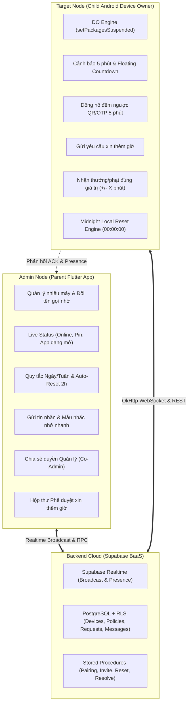
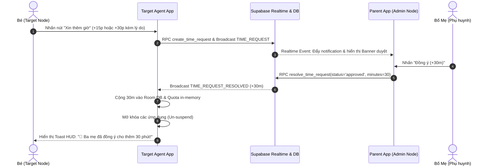
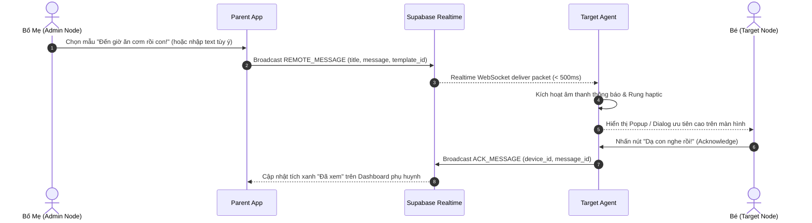
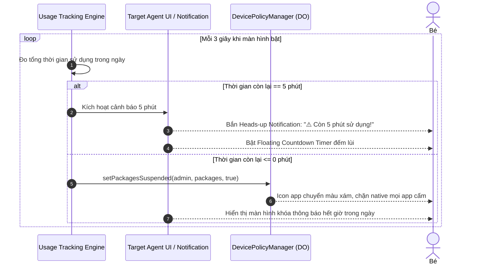

# 🌟 TỔNG QUAN EPICS GIAI ĐOẠN 2: HOÀN THIỆN LOGIC NGHIỆP VỤ & VẬN HÀNH ĐA THIẾT BỊ

- **Phiên bản**: Giai đoạn 2 (Phase 2 - Business Logic & Multi-Device Control)
- **Hệ thống**: Android MDM Parental Control
- **Kiến trúc**: 3 Tầng (Admin App Flutter - Supabase BaaS Orchestrator - Child Android Device Owner Native)
- **Agent điều phối**: `lead-architect`
- **Mục tiêu cốt lõi**: Nâng cấp toàn diện trải nghiệm người dùng và tính toàn vẹn của logic điều khiển: quản lý nhiều con/nhiều máy, trạng thái telemetry chuẩn xác, chia sẻ quyền phụ huynh, cấu hình giới hạn ngày/tuần tự động reset 00:00, giao tiếp tương tác 2 chiều (gửi tin nhắn nhắc nhở, xin thêm giờ, cảnh báo 5 phút, đếm ngược mã ghép nối).

---

## 🏛️ 1. Bối Cảnh & Kiến Trúc Tổng Thể Giai Đoạn 2

Trong Giai đoạn 1, hệ thống đã hoàn thiện nền tảng kỹ thuật cốt lõi:
- Kích hoạt Android Device Owner và bộ chính sách Anti-Tampering (Zero-Bypass).
- Thu thập UsageEvents chuẩn mili-giây và chạy ngầm tiết kiệm pin (< 3-5%/ngày).
- Chuyển đổi hạ tầng sang Supabase Realtime (WebSockets) và FCM Fallback.
- Giao diện Admin Flutter & Child Compose ban đầu.

**Giai đoạn 2** tập trung giải quyết triệt để **Logic Nghiệp Vụ Vận Hành Thực Tế** giữa Phụ huynh và Con cái:

---

## 📋 2. Ma Trận Phân Rã Epics Giai Đoạn 2

Hệ thống Epics Giai đoạn 2 được chia thành 3 nhóm tài liệu chuyên biệt:

| Mã Epic | Tên Epic | Thành phần | Agent Chuyên Trách | Tài Liệu Chi Tiết |
| :--- | :--- | :--- | :--- | :--- |
| **P2-ADMIN-01** | Quản lý Nhiều Thiết Bị Con & Đổi Tên Gợi Nhớ | `admin-node` | `parent-ui-specialist` | [`PHASE_2_ADMIN_NODE_EPICS.md`](./PHASE_2_ADMIN_NODE_EPICS.md) |
| **P2-ADMIN-02** | Hiển Thị Trạng Thái Telemetry & Live Status | `admin-node` | `parent-ui-specialist` | [`PHASE_2_ADMIN_NODE_EPICS.md`](./PHASE_2_ADMIN_NODE_EPICS.md) |
| **P2-ADMIN-03** | Hủy Quản Lý & Xóa Thiết Bị (Unpairing / Revoke) | `admin-node` | `parent-ui-specialist` | [`PHASE_2_ADMIN_NODE_EPICS.md`](./PHASE_2_ADMIN_NODE_EPICS.md) |
| **P2-ADMIN-04** | Chia Sẻ Quyền Quản Lý (Co-Admin Family Sharing) | `admin-node` | `parent-ui-specialist` | [`PHASE_2_ADMIN_NODE_EPICS.md`](./PHASE_2_ADMIN_NODE_EPICS.md) |
| **P2-ADMIN-05** | Quy Tắc Giới Hạn Giờ (Ngày / Tuần) & Tự Động Reset | `admin-node` | `parent-ui-specialist` | [`PHASE_2_ADMIN_NODE_EPICS.md`](./PHASE_2_ADMIN_NODE_EPICS.md) |
| **P2-ADMIN-06** | Gửi Tin Nhắn Nhắc Nhở & Mẫu Câu Nhanh | `admin-node` | `parent-ui-specialist` | [`PHASE_2_ADMIN_NODE_EPICS.md`](./PHASE_2_ADMIN_NODE_EPICS.md) |
| **P2-CHILD-01** | Nhận Thưởng / Phạt Giờ Chơi Theo Giá Trị Động | `target-node` | `device-owner-specialist` | [`PHASE_2_TARGET_NODE_EPICS.md`](./PHASE_2_TARGET_NODE_EPICS.md) |
| **P2-CHILD-02** | Luồng Gửi Yêu Cầu Xin Thêm Giờ Từ Máy Con | `target-node` | `usage-tracking-specialist` | [`PHASE_2_TARGET_NODE_EPICS.md`](./PHASE_2_TARGET_NODE_EPICS.md) |
| **P2-CHILD-03** | Cảnh Báo 5 Phút Còn Lại & Đếm Ngược Thời Gian | `target-node` | `usage-tracking-specialist` | [`PHASE_2_TARGET_NODE_EPICS.md`](./PHASE_2_TARGET_NODE_EPICS.md) |
| **P2-CHILD-04** | Đếm Ngược Thời Gian Hiệu Lực QR Code & OTP (TTL 5p) | `target-node` | `device-owner-specialist` | [`PHASE_2_TARGET_NODE_EPICS.md`](./PHASE_2_TARGET_NODE_EPICS.md) |
| **P2-CHILD-05** | Engine Tự Động Reset Cục Bộ Lúc 00:00 (Offline Resilient) | `target-node` | `usage-tracking-specialist` | [`PHASE_2_TARGET_NODE_EPICS.md`](./PHASE_2_TARGET_NODE_EPICS.md) |
| **P2-BACKEND-01** | Thiết Kế Lược Đồ Dữ Liệu & Migration Supabase Mở Rộng | `backend` | `backend-sync-specialist` | [`PHASE_2_BACKEND_SUPABASE_EPICS.md`](./PHASE_2_BACKEND_SUPABASE_EPICS.md) |
| **P2-BACKEND-02** | Kênh Realtime Broadcast, Presence & Event Payload | `backend` | `backend-sync-specialist` | [`PHASE_2_BACKEND_SUPABASE_EPICS.md`](./PHASE_2_BACKEND_SUPABASE_EPICS.md) |
| **P2-BACKEND-03** | Stored Procedures RPC & Row Level Security (RLS) | `backend` | `backend-sync-specialist` | [`PHASE_2_BACKEND_SUPABASE_EPICS.md`](./PHASE_2_BACKEND_SUPABASE_EPICS.md) |
| **P2-QA-01** | QA, Security Audit, Anti-Bypass & Battery Profiling | Toàn bộ | `qa-security-perf-specialist` | [`PHASE_2_EPICS_OVERVIEW.md`](#5-kế-hoạch-kiểm-thử--đánh-giá-bảo-mật-p2-qa-01) |

---

## 🔄 3. Luồng Tương Tác Nghiệp Vụ Cốt Lõi (Sequence Diagrams)

### 3.1. Luồng Con Xin Thêm Giờ & Bố Mẹ Phê Duyệt Tức Thì

### 3.2. Luồng Bố Mẹ Gửi Tin Nhắn Nhắc Nhở Nhanh Xuống Máy Con

### 3.3. Luồng Cảnh Báo 5 Phút & Tự Động Khóa Khi Hết Hạn Mức

---

## 🛠️ 4. Bảng Quy Định Tham Số & Logic Chuẩn Hóa

### 4.1. Quy tắc Quota Ngày & Reset (Daily Limit & Midnight Reset)
- **Hạn mức mặc định**: 120 phút (2 giờ) / ngày.
- **Dải điều chỉnh**: 15 phút đến 480 phút (8 giờ), bước nhảy 15 phút.
- **Thời khắc reset**: Đúng `00:00:00` (nửa đêm) theo giờ máy con:
  - Thời gian đã dùng trong ngày: Trở về `0 phút`.
  - Hạn mức ngày: Trở về đúng giá trị cấu hình cơ sở (xóa các giá trị thưởng/phạt tạm thời của ngày hôm trước).
  - Trạng thái khóa: Tự động un-suspend toàn bộ ứng dụng nếu bị khóa do hết quota ngày hôm trước (trừ trường hợp đang trong khung giờ Đi Ngủ - Bedtime).
  - Cơ chế thực thi: **Local-First**, sử dụng `AlarmManager.setExactAndAllowWhileIdle()` lập lịch cục bộ, không phụ thuộc vào việc có mạng internet hay không.

### 4.2. Quy tắc Quota Tuần (Weekly Limit)
- **Hạn mức mặc định**: 840 phút (14 giờ) / tuần.
- **Cơ chế phân bổ**: 
  - Đặt trần tối đa cho từng ngày (Daily Cap) để tránh con dùng hết sạch quota tuần trong 1-2 ngày đầu tuần.
  - Reset quỹ thời gian tuần vào `00:00:00` Thứ Hai hàng tuần.

### 4.3. Giá trị Thưởng / Phạt Động (Dynamic Bonus / Penalty)
- Thưởng giờ chơi: `+15m`, `+30m`, `+45m`, `+60m`, hoặc số phút tùy chỉnh.
- Phạt trừ giờ chơi: `-15m`, `-30m`, `-45m`.
- Xử lý khi bị trừ giờ:
  - Nếu `(Thời gian đã dùng) >= (Hạn mức mới sau khi trừ)`: Lập tức kích hoạt lệnh khóa hệ điều hành `setPackagesSuspended` ngay tại thời điểm nhận lệnh.

### 4.4. Đếm ngược Mã Ghép Nối (Pairing TTL Countdown)
- **Thời gian hiệu lực**: 300 giây (5 phút).
- Hiển thị đồng hồ đếm lùi: `mm:ss` (ví dụ: `04:59` -> `00:00`).
- Khi còn dưới 60 giây: Đổi màu cảnh báo màu vàng cam.
- Khi hết giờ (00:00): Làm mờ mã QR và số OTP, hiện nút "Tạo mã mới".

---

## 🛡️ 5. Kế Hoạch Kiểm Thử & Đánh Giá Bảo Mật (P2-QA-01)

Đội ngũ QA (`qa-security-perf-specialist`) sẽ tiến hành rà soát các tiêu chuẩn nghiệm thu nghiêm ngặt:
1. **Kiểm thử Zero-Bypass**:
   - Thử chỉnh lùi giờ hệ thống qua múi giờ khác để lách thời điểm reset 00:00 (Phải bị chặn bởi `DISALLOW_CONFIG_DATE_TIME` và `setAutoTimeRequired`).
   - Thử tắt kết nối Wi-Fi/4G xem máy con có tự động reset quota lúc 00:00 và khóa khi hết giờ hay không (Offline Resilient).
2. **Kiểm thử Đồng bộ & Trễ (Latency Benchmark)**:
   - Thử nghiệm gửi tin nhắn nhắc nhở và lệnh thưởng/phạt từ Admin App -> Target Agent phải nhận và hiển thị trong vòng < 2 giây.
   - Luồng xin thêm giờ: Phụ huynh duyệt -> Target Agent mở khóa trong vòng < 2 giây.
3. **Kiểm thử Đa thiết bị (Multi-Device Isolation)**:
   - Đảm bảo lệnh điều khiển gửi tới `Device A` không bị rò rỉ hoặc ảnh hưởng tới `Device B` trong cùng một gia đình.
   - Thử nghiệm Co-Admin: 2 điện thoại phụ huynh cùng đăng nhập, cùng nhận thông báo Realtime mà không xung đột trạng thái.
4. **Kiểm tra Pin & Hiệu năng (Battery Profiling)**:
   - Vòng lặp đếm ngược 5 phút và Service chạy ngầm duy trì mức tiêu thụ pin < 3-5%/ngày. Không giữ CPU WakeLock liên tục khi màn hình tắt.

---

## 🎯 6. Tiêu Chuẩn Hoàn Thành (Definition of Done - DoD Giai Đoạn 2)

- [ ] Toàn bộ các tài liệu chi tiết Phase 2 được ban hành đầy đủ và thống nhất.
- [ ] Database Schema mới và các Stored Procedures được áp dụng hoàn tất trên Supabase.
- [ ] App Admin (Flutter) hỗ trợ đầy đủ các tính năng: danh sách đa thiết bị, đổi tên, trạng thái trực tiếp, xóa thiết bị, mời co-admin, cấu hình quy tắc ngày/tuần, gửi tin nhắn.
- [ ] App Con (Kotlin) hỗ trợ đầy đủ: thưởng/phạt động, xin thêm giờ, cảnh báo 5p + đếm ngược, đếm ngược QR code, auto-reset 00:00 offline.
- [ ] Vượt qua toàn bộ checklist bảo mật của `qa-security-perf-specialist`.
- [ ] Nhật ký thực thi `docs/logs/` được cập nhật chi tiết từng bước.
