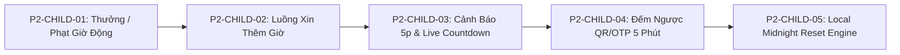

# 📱 EPICS CHI TIẾT GIAI ĐOẠN 2: TARGET-NODE (CHILD DEVICE OWNER AGENT)

- **Thành phần**: `target-node` (Android Native Application - Kotlin)
- **Đặc quyền**: **Android Device Owner (DO)** cấp doanh nghiệp
- **Agent phụ trách**: `device-owner-specialist` & `usage-tracking-specialist`
- **Mục tiêu**: Hoàn thiện tầng thực thi và tương tác cục bộ: xử lý thưởng/phạt giờ chơi chính xác giá trị động, cho phép con xin thêm giờ, cảnh báo sớm 5 phút kèm đếm ngược, hiển thị đếm ngược mã pairing 5 phút và tự động reset hạn mức lúc nửa đêm bất kể online hay offline.

---

## 📑 Danh Mục Epics Giai Đoạn 2 (Target Node)



---

## 📌 P2-CHILD-01: Nhận Thưởng / Phạt Giờ Chơi Theo Giá Trị Động (Dynamic Bonus & Penalty Enforcement)

### 1. Bối cảnh & Vấn đề hiện tại
- Trong phiên bản Giai đoạn 1, handler `GRANT_EXTRA_TIME` trong `UsageTrackingForegroundService` và `MdmSupabaseClient` đang mặc định gán hoặc coi mọi lệnh là `+15 phút`.
- Khi phụ huynh thưởng 30 phút, 1 giờ hoặc phạt trừ giờ chơi (-15m, -30m), máy con chưa xử lý đúng giá trị động, gây sai lệch nghiêm trọng giữa số liệu trên máy phụ huynh và thời gian thực tế của con.

### 2. User Stories & Nhiệm Vụ Chi Tiết
#### US 1.1: Hỗ Trợ Gói Tin Thưởng / Phạt Đa Giá Trị (Dynamic Payload Parser)
- Mở rộng xử lý event `GRANT_EXTRA_TIME` và `APPLY_PENALTY_TIME`:
  - Payload nhận vào:
    ```json
    {
      "event": "ADJUST_SCREEN_TIME",
      "delta_minutes": 30, // Dương: Thưởng (+15, +30, +60), Âm: Phạt (-15, -30)
      "reason": "Hoàn thành bài tập về nhà xuất sắc",
      "sender_name": "Mẹ",
      "timestamp": 1793525000000
    }
    ```
- **Xử lý số học Quota**:
  - `Hạn mức mới = Hạn mức hiện tại + delta_minutes`.
  - Cập nhật ngay vào Room Database: bảng `cached_policies` (`dailyLimitMinutes`) và SharedPreferences.

#### US 1.2: Thực Thi Khóa Tức Thì Nếu Phạt Vượt Quá Thời Gian Đã Dùng
- Nếu nhận lệnh phạt (ví dụ: `-30 phút`) khiến:
  `Thời gian đã sử dụng >= Hạn mức mới sau khi trừ`
  - Hệ thống **lập tức kích hoạt lệnh khóa hệ điều hành**:
    `DevicePolicyManager.setPackagesSuspended(admin, packagesToSuspend, true)`
  - Khóa màn hình máy: `dpm.lockNow()`.
  - Hiển thị thông báo: *"⚠️ Ba mẹ đã trừ 30 phút giờ chơi do vi phạm quy định. Hạn mức hôm nay đã hết!"*.

#### US 1.3: Hiển Thị Thông Báo HUD Động Chuẩn Xác
- **Khi được thưởng**:
  - Bắn thông báo Heads-up / Toast xanh: `"🎁 Ba mẹ đã thưởng thêm [X] phút sử dụng! Chúc con có thời gian vui vẻ!"`.
  - Nếu app đang bị suspended do hết giờ trước đó: Tự động un-suspend ngay lập tức.
- **Khi bị phạt**:
  - Bắn thông báo màu cam/đỏ: `"⚠️ Ba mẹ đã trừ [X] phút giờ chơi. Lý do: [Lý do]!"`.
- **Gửi phản hồi ACK**:
  - Gửi tin nhắn ACK về Supabase Channel để phụ huynh biết lệnh đã được áp dụng thành công trên máy con.

### 3. Tiêu Chuẩn Nghiệm Thu (Acceptance Criteria)
- [ ] Xử lý đúng các mức thưởng: `+15m`, `+30m`, `+45m`, `+60m` và phạt: `-15m`, `-30m`.
- [ ] Tính toán lại quota trong Room DB chuẩn xác trong vòng < 500ms.
- [ ] Tự động un-suspend khi được thưởng và lập tức suspend khi bị phạt vượt quota.
- [ ] Phản hồi mã ACK lên Supabase Realtime đầy đủ.

---

## 📌 P2-CHILD-02: Luồng Gửi Yêu Cầu Xin Thêm Giờ Từ Máy Con (Interactive Time Request Flow)

### 1. Bối cảnh & Vấn đề hiện tại
- Trẻ khi dùng máy sắp hết giờ hoặc khi app đã bị suspend thường không có kênh tương tác chính thống để xin phép bố mẹ, dẫn đến việc khóc lóc hoặc tìm cách gian lận, phá máy.
- Cần có nút bấm văn minh để con gửi yêu cầu kèm lý do lên điện thoại bố mẹ.

### 2. User Stories & Nhiệm Vụ Chi Tiết
#### US 2.1: Giao Diện Nút "Xin Thêm Giờ" Trên Màn Hình Con
- **Vị trí**:
  - Hiển thị trên màn hình chính của ứng dụng `target-node`.
  - Xuất hiện trên màn hình thông báo khi app bị khóa (Lockout Screen).
  - Xuất hiện trong thanh thông báo (Notification Action) khi còn 5 phút.
- **Hộp thoại xin thêm giờ (Request Time Dialog)**:
  - Cho bé chọn thời gian muốn xin:
    - `[ +15 Phút ]`
    - `[ +30 Phút ]`
    - `[ +45 Phút ]`
  - Chọn lý do mẫu bằng icon dễ thương:
    - 📖 *"Con chưa làm xong bài tập"*
    - 🎮 *"Con chơi nốt trận này với bạn"*
    - 🎥 *"Con xem nốt tập phim khoa học"*
    - 💬 *"Lý do khác..."* (cho phép gõ ngắn).

#### US 2.2: Gửi Yêu Cầu & Quản Lý Trạng Thái Chờ (Pending State)
- Khi bé nhấn `"Gửi yêu cầu tới Ba Mẹ"`:
  - Tạo một bản ghi trên bảng `time_requests` qua Supabase RPC `create_time_request`.
  - Bắn broadcast Realtime event `TIME_REQUEST` tới kênh gia đình.
  - Chuyển nút bấm sang trạng thái chờ:
    - Hiệu ứng loading xoay tròn nhẹ: `"Đã gửi yêu cầu, đang chờ Ba Mẹ trả lời..."`.
    - Khóa nút bấm trong 3 phút (Cooldown) để tránh trẻ spam gửi hàng chục yêu cầu liên tục.

#### US 2.3: Xử Lý Phản Hồi Phê Duyệt Tức Thì (Resolution Handler)
- Lắng nghe event `TIME_REQUEST_RESOLVED` từ Supabase Realtime:
  - **Trường hợp Phụ huynh Đồng Ý (Approved)**:
    - Nhận số phút được cấp (ví dụ +30m).
    - Tự động cộng vào Quota cục bộ.
    - Mở khóa (un-suspend) toàn bộ ứng dụng ngay lập tức.
    - Hiển thị thông báo vui mừng: `"🎉 Tuyệt vời! Ba mẹ đã đồng ý cho con thêm 30 phút!"`.
  - **Trường hợp Phụ huynh Từ Chối (Rejected)**:
    - Hiển thị thông báo nhẹ nhàng: `"Ba mẹ bận hoặc chưa đồng ý lúc này. Con hãy nghỉ ngơi một chút nhé!"`.
    - Trả trạng thái nút về bình thường sau thời gian cooldown.

### 3. Tiêu Chuẩn Nghiệm Thu (Acceptance Criteria)
- [ ] Giao diện xin giờ thân thiện với trẻ, có sẵn các mẫu lý do thông dụng.
- [ ] Cơ chế chống spam (Cooldown 3 phút giữa mỗi lần gửi).
- [ ] Nhận kết quả phê duyệt và mở khóa ứng dụng trong vòng < 2 giây sau khi phụ huynh bấm duyệt.

---

## 📌 P2-CHILD-03: Cảnh Báo 5 Phút Còn Lại & Đếm Ngược Thời Gian (5-Minute Warning & Live Countdown HUD)

### 1. Bối cảnh & Vấn đề hiện tại
- Trẻ thường bị sốc hoặc bức xúc khi máy đột ngột bị khóa mà không được báo trước, dẫn đến việc mất dữ liệu dở dang (chưa kịp lưu bài học, trận game đang dở).
- Quy chuẩn giáo dục và công nghệ phụ huynh hiện đại đòi hỏi phải có cảnh báo trước 5 phút để trẻ chủ động kết thúc hoạt động.

### 2. User Stories & Nhiệm Vụ Chi Tiết
#### US 3.1: Cơ Chế Kích Hoạt Cảnh Báo 5 Phút (5-Minute Threshold Detection)
- Trong vòng lặp polling của `UsageTrackingForegroundService`:
  - Liên tục tính toán: `Thời gian còn lại = Hạn mức ngày - Thời gian đã dùng`.
  - Khi `Thời gian còn lại == 5 phút` (khoảng 300 giây):
    - Đánh dấu cờ `is5MinWarningTriggered = true` (đảm bảo chỉ phát 1 lần cho mỗi chu kỳ).
    - Phát âm thanh cảnh báo hệ thống nhẹ nhàng + Rung 2 nhịp (Haptic Pulse).

#### US 3.2: Heads-up Notification Ưu Tiên Cao
- Bắn Notification ưu tiên cao (`NotificationCompat.PRIORITY_HIGH` / `IMPORTANCE_HIGH`) nổi lên trên màn hình:
  - **Tiêu đề**: `"⚠️ Chú ý: Còn đúng 5 phút sử dụng!"`
  - **Nội dung**: `"Thiết bị sẽ tự động khóa sau 5 phút. Hãy lưu bài tập và chuẩn bị tắt máy nhé con!"`
  - **Nút hành động nhanh**: `[ Xin thêm 15p ]` (Mở nhanh dialog xin giờ mà không cần tìm app).

#### US 3.3: Floating Countdown Timer / Đếm Ngược Trực Quan
- Khi thời gian còn <= 5 phút:
  - Trong Notification: Cập nhật dòng đếm ngược từng phút (`04:59`, `03:00`, `01:00`).
  - Khi mở app `target-node`: Vòng tròn tiến độ đổi sang màu cam cảnh báo kèm đồng hồ đếm lùi từng giây sống động.
  - Khi đồng hồ chạm mốc `00:00`:
    - Rung dài báo hiệu hết giờ.
    - Gọi ngay `dpm.setPackagesSuspended(admin, packages, true)` khóa toàn diện.

### 3. Tiêu Chuẩn Nghiệm Thu (Acceptance Criteria)
- [ ] Cảnh báo kích hoạt chính xác tại mốc 5 phút còn lại.
- [ ] Heads-up notification nổi lên màn hình kèm âm thanh và rung, không bị Android chặn.
- [ ] Đếm ngược mượt mà từng giây/phút và tự động khóa native khi về 00:00.

---

## 📌 P2-CHILD-04: Đếm Ngược Thời Gian Hiệu Lực QR Code & OTP (Pairing TTL Countdown 5p)

### 1. Bối cảnh & Vấn đề hiện tại
- Mã OTP 6 số và mã QR token do Supabase cấp chỉ có hiệu lực trong vòng 5 phút (TTL 300 giây) để bảo đảm an toàn.
- Hiện tại màn hình máy con chưa có đồng hồ đếm ngược, khiến trẻ hoặc phụ huynh không biết khi nào mã hết hạn, dẫn đến việc quét mã hết hạn và báo lỗi khó hiểu.

### 2. User Stories & Nhiệm Vụ Chi Tiết
#### US 4.1: Đồng Hồ Đếm Ngược 5 Phút Sống Động (Pairing TTL Timer HUD)
- **Vị trí**: Nằm ngay dưới khung hiển thị mã QR và số OTP trên màn hình `MainActivity` (Compose).
- **Trình bày**:
  - Thanh tiến độ tuyến tính (Linear Progress Bar) hoặc viền tròn chạy lùi từ 100% về 0%.
  - Văn bản đếm lùi định dạng `mm:ss` (ví dụ: `⏱️ Mã có hiệu lực trong: 04:35`).
  - Hiệu ứng màu sắc:
    - Xanh lá cây / Apple Red (> 60 giây): Trạng thái bình thường.
    - Cam hổ phách (< 60 giây): Cảnh báo sắp hết giờ.

#### US 4.2: Xử Lý Khi Hết Hạn 5 Phút (Expired State & Auto-Refresh)
- Khi bộ đếm chạm mốc `00:00`:
  - Tự động làm mờ (Blur / Dim 50%) khung mã QR và 6 chữ số OTP.
  - Phủ lên nhãn: `"⚠️ Mã đã hết hạn hiệu lực"`.
  - Hiển thị nút bấm nổi bật bo tròn: `"🔄 Tạo mã ghép nối mới"`.
  - Nhấn nút lập tức gọi `createPairingSession` để xin mã mới từ Supabase và khởi động lại chu kỳ đếm ngược 5 phút.

### 3. Tiêu Chuẩn Nghiệm Thu (Acceptance Criteria)
- [ ] Đếm ngược chính xác từng giây từ 05:00 về 00:00.
- [ ] Đổi màu cảnh báo trực quan khi còn dưới 1 phút.
- [ ] Khi hết hạn, mã cũ bị vô hiệu hóa trên giao diện và có nút tạo mã mới hoạt động trơn tru.

---

## 📌 P2-CHILD-05: Engine Tự Động Reset Cục Bộ Lúc 00:00:00 (Local Midnight Reset Engine)

### 1. Bối cảnh & Vấn đề hiện tại
- Nếu chỉ dựa vào tín hiệu từ Backend để reset số liệu lúc 00:00, khi máy con bị tắt Wi-Fi/4G qua đêm hoặc khi máy con ở chế độ Deep Sleep, việc reset sẽ bị thất bại.
- Hôm sau thức dậy, máy con vẫn giữ số liệu ngày cũ và tiếp tục bị khóa oan uổng.

### 2. User Stories & Nhiệm Vụ Chi Tiết
#### US 5.1: Lập Lịch Đánh Thức Cục Bộ Bằng AlarmManager
- Sử dụng Android `AlarmManager.setExactAndAllowWhileIdle()` với cờ `RTC_WAKEUP`:
  - Tính toán chính xác thời điểm `00:00:00` của ngày hôm sau theo múi giờ thiết bị.
  - Kích hoạt `MidnightResetReceiver : BroadcastReceiver`.

#### US 5.2: Logic Reset Nửa Đêm Bất Tử (Zero-Loss Midnight Routine)
Khi đến thời khắc 00:00:00 (kể cả khi mất mạng internet):
1. **Reset Thống Kê**:
   - Lưu trữ bản ghi tổng kết ngày cũ vào Room DB.
   - Tạo bản ghi mới cho ngày hôm nay với `total_time_ms = 0`.
2. **Reset Hạn Mức**:
   - Trả `dailyLimitMinutes` về đúng giá trị cấu hình cơ sở (mặc định 120 phút hoặc hạn mức ngày trong tuần do phụ huynh đặt).
   - Xóa bỏ toàn bộ biến tạm `extra_time_minutes` của ngày hôm trước.
3. **Mở Khóa Ứng Dụng (Un-suspend All)**:
   - Nếu máy đang bị suspend do hết quota ngày cũ: Gọi ngay `dpm.setPackagesSuspended(admin, packages, false)` để mở khóa toàn bộ ứng dụng cho ngày mới.
   - Ngoại lệ: Nếu thời điểm 00:00 vẫn nằm trong khung giờ Đi Ngủ (Bedtime Mode, ví dụ 21:30 đến 06:30) thì vẫn duy trì khóa cho tới khi hết giờ Bedtime.
4. **Lập Lịch Cho Ngày Kế Tiếp**:
   - Tự động đặt lại Alarm cho 00:00:00 của đêm tiếp theo.

### 3. Tiêu Chuẩn Nghiệm Thu (Acceptance Criteria)
- [ ] Cơ chế reset tự chạy đúng 00:00:00 ngay cả khi không có kết nối internet.
- [ ] Thời gian sử dụng trở về 0, hạn mức trở về giá trị mặc định chuẩn.
- [ ] Ứng dụng tự động un-suspend cho ngày mới sau khi reset.
